# Batch 10: real-gym moments

Adds the 21 batch 10 assets from the existing source definitions: three poses for all four builds, Mark's walks and spotting pose, the whiteboard, personal-best bell and ring effect, vending machine, and seat bench. Started from latest main at `b5e3471`.

There are **54 character animation frames**, **4 bell animation frames**, and **4 still props**. Character cells are 32×48 with feet on zero-based row 46 and anchor (16,46). Palettes, dimensions, frame counts, asset definitions and application code are unchanged. `art/ASSETS.md` and `assets/manifest.json` are excluded as requested.

## Four builds side by side at 2×

Left to right in every image: **Noodle (0), Toned (1), Buff (2), Maxxed (3)**. Each GIF uses the asset's playback speed. The linked PNGs show every phase in rows, with all four builds side by side at exact 2×.

| Pose | Loop at 2× | All phases |
| --- | --- | --- |
| Spot — two frames, 3 fps | 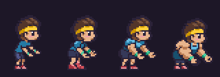 | [PNG](spot.four-builds@2x.png) |
| Wave — four frames, 8 fps | 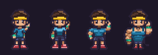 | [PNG](wave.four-builds@2x.png) |
| Breathe — four frames, 4 fps | 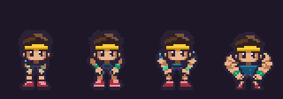 | [PNG](breathe.four-builds@2x.png) |

Spotting is a right-facing side view, leaning forward with two low, open, empty hands. No bench or bar is baked into those strips. Breathing uses two held rest/inhale drawings across four frames, with a one-pixel rise in the middle phases; hands remain on the knees and feet stay planted. Waving has four distinct arm poses.

## Spotting at the bench head

Left to right: Noodle, Toned, Buff, Maxxed, Mark. The character anchor is at the game's exact `spotterSpot` offset **(-22,-10)** from the bench floor point. This registration plate draws the approved `bench_back` first so the hand placement stays visible.

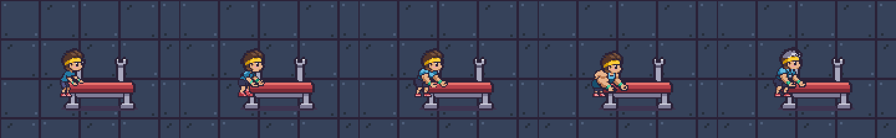

[Both phases at 2×](spot.on-bench@2x.png). [Occupied bench with the existing lifter and game depth order](spot.occupied-bench@2x.gif); [both occupied phases](spot.occupied-bench@2x.png). Preview arrangements do not change the game layout.

## Mark walking beside his idle

Left to right: approved Mark idle, walk down, walk up, walk right. The GIF preserves idle at 6 fps and walking at 10 fps over their common two-second cycle.

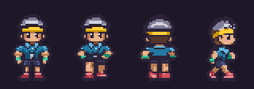

[All Mark strips and spotting frames at 2×](mark.all-strips@2x.png). The gray cap, polo collar and whistle remain Mark's outfit; the whistle appears on the front/visible side of the polo, with no whistle on his back.

## Wall props and the personal-best bell

This crop uses the existing back-wall tiles and the renderer's wall-prop coordinates. The new whiteboard is on the left and the new personal-best bell on the right. Scribbles and tally strokes contain no readable letters or numbers.

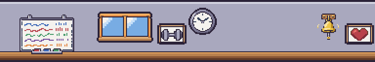

[Still wall strip](wall-props@2x.png).

Left below is the still bell; right is its ringing replacement. Bracket rows 0–12 are byte-identical in all four effect frames. Effect rest frames 1 and 3 reuse the still bell's body and rope; the alternate frames swing around the same fixed bracket.

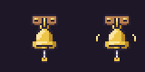

## Cooler lounge

The new vending machine has unlabeled abstract packages and bottles, coin slot, buttons and dispensing opening. The seat bench has a padded cushion and wooden legs, without a backrest.

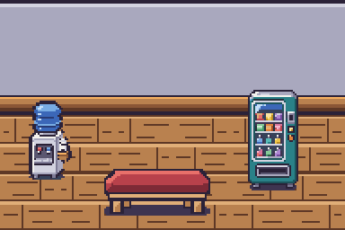

## Every asset beside the approved style tile at 2×

The pose comparisons contain all frames of all four builds, with the approved tile on the left. The Mark comparison contains all four new Mark strips. The prop comparison contains all five environment assets, including all four ring frames.

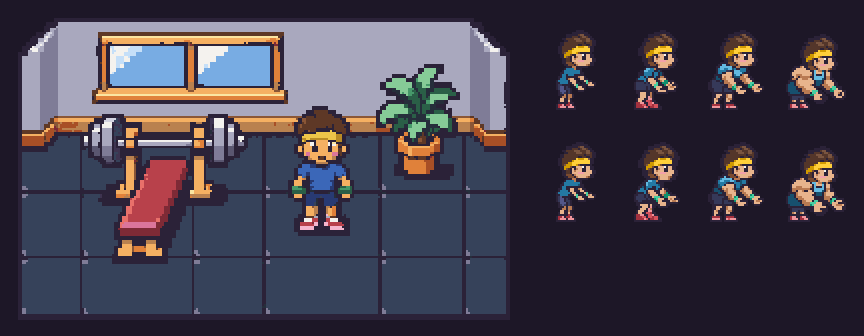

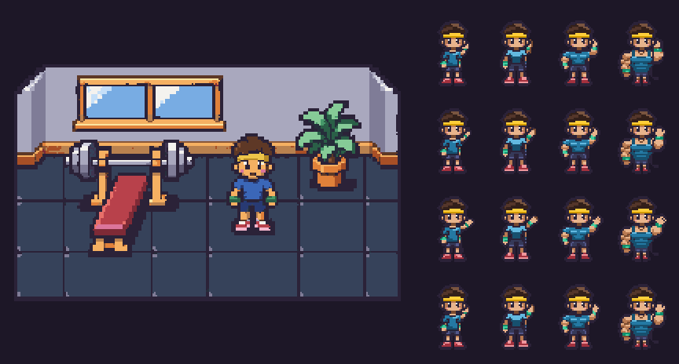

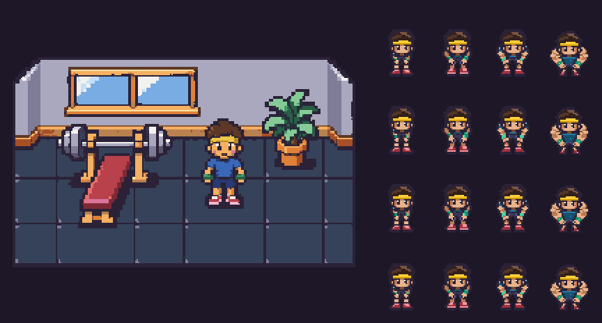

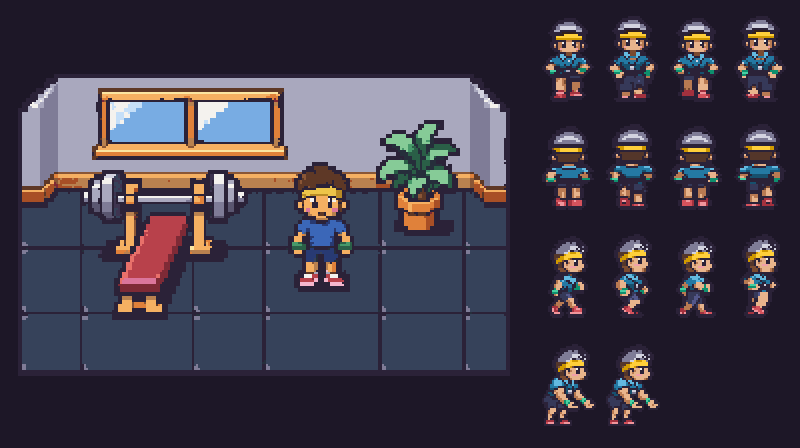

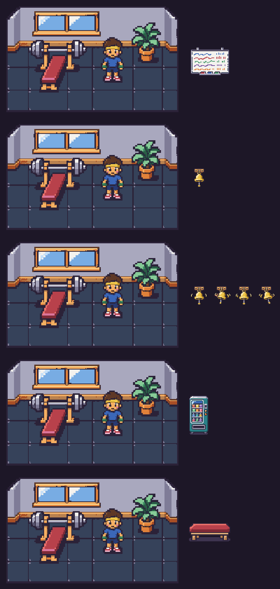

## Asset files

| Id | Finished asset | PNG size | Frames | Palette |
| --- | --- | --- | --- | --- |
| `char.build-0.spot` | [PNG](../../../assets/characters/build-0/spot.png) | 64×48 | 2 @ 3 fps | character |
| `char.build-0.wave` | [PNG](../../../assets/characters/build-0/wave.png) | 128×48 | 4 @ 8 fps | character |
| `char.build-0.breathe` | [PNG](../../../assets/characters/build-0/breathe.png) | 128×48 | 4 @ 4 fps | character |
| `char.build-1.spot` | [PNG](../../../assets/characters/build-1/spot.png) | 64×48 | 2 @ 3 fps | character |
| `char.build-1.wave` | [PNG](../../../assets/characters/build-1/wave.png) | 128×48 | 4 @ 8 fps | character |
| `char.build-1.breathe` | [PNG](../../../assets/characters/build-1/breathe.png) | 128×48 | 4 @ 4 fps | character |
| `char.build-2.spot` | [PNG](../../../assets/characters/build-2/spot.png) | 64×48 | 2 @ 3 fps | character |
| `char.build-2.wave` | [PNG](../../../assets/characters/build-2/wave.png) | 128×48 | 4 @ 8 fps | character |
| `char.build-2.breathe` | [PNG](../../../assets/characters/build-2/breathe.png) | 128×48 | 4 @ 4 fps | character |
| `char.build-3.spot` | [PNG](../../../assets/characters/build-3/spot.png) | 64×48 | 2 @ 3 fps | character |
| `char.build-3.wave` | [PNG](../../../assets/characters/build-3/wave.png) | 128×48 | 4 @ 8 fps | character |
| `char.build-3.breathe` | [PNG](../../../assets/characters/build-3/breathe.png) | 128×48 | 4 @ 4 fps | character |
| `npc.mark.walk_down` | [PNG](../../../assets/characters/npc-mark/walk_down.png) | 128×48 | 4 @ 10 fps | character |
| `npc.mark.walk_up` | [PNG](../../../assets/characters/npc-mark/walk_up.png) | 128×48 | 4 @ 10 fps | character |
| `npc.mark.walk_side` | [PNG](../../../assets/characters/npc-mark/walk_side.png) | 128×48 | 4 @ 10 fps | character |
| `npc.mark.spot` | [PNG](../../../assets/characters/npc-mark/spot.png) | 64×48 | 2 @ 3 fps | character |
| `prop.whiteboard` | [PNG](../../../assets/props/whiteboard.png) | 64×48 | 1 | environment |
| `prop.pb_bell` | [PNG](../../../assets/props/pb_bell.png) | 32×32 | 1 | environment |
| `fx.bell_ring` | [PNG](../../../assets/fx/bell_ring.png) | 128×32 | 4 @ 10 fps | environment |
| `prop.vending_machine` | [PNG](../../../assets/props/vending_machine.png) | 32×64 | 1 | environment |
| `prop.seat_bench` | [PNG](../../../assets/props/seat_bench.png) | 64×32 | 1 | environment |

## Generation, cleanup and validation

- Built-in imagegen produced one asset per image on flat magenta. Every generation attached the approved style tile. Each build also used its own standing reference and idle strip; spotting used its approved right-facing side view. Enlarged references are nearest-neighbour copies of those exact approved pixels. Mark used his approved idle plus the Buff motion/body references. The effect attached the cleaned still bell. Exact prompts and raw outputs remain local and ignored in `art/raw/batch-10/`.
- Approved head pixels are restored without scaling. Their dimensions remain identical across builds and phases; spotting uses the approved right-profile head, waving uses the front idle head, and the bent breathing poses lower that same head with the body. Mark's walking skin, legs and clothing silhouette start from the approved Buff walk geometry, with his generated outfit details registered onto it.
- Every asset was cleaned with `pnpm pixelize`. Registered animation strips received a final exact 8× staging pass through `pixelize strip`. Integer translations reverse the tool's automatic bounding-box centring; each restored strip was compared byte for byte with its native registered grid. Color drift on hands was snapped to the skin ramp.
- **Final pixelize cleanup warnings: none. Pixelize check warnings: none. All 21 explicit-size checks pass.** No off-palette pixels, half transparency, remaining magenta or changed frame counts.
- The initial Maxxed wave cleanup reported **“Found 3 separate frames but expected 4”**: an 8-image-pixel key-color gap was smaller than the 16-image-pixel cleanup threshold. The four sprites were already separate. Adding 64-pixel magenta gutters between the intact source sprites resolved segmentation without altering any artwork.
- Native audit: 54 character foot baselines at row 46, row 47 clear, one connected character silhouette per frame, exact approved head pixels per phase, head-only ramps restricted to the head, no shoe colors on hands, fixed wave lower bodies, fixed spot shoes, and exact bell bracket/rest-frame registration. Every GIF uses an exact shared color table, without dithering.
- `pnpm test`: **132 passed**. `pnpm typecheck`: **passed**.
- `pnpm assets:status`: **148/148** first-version assets present; exactly the 21 batch 10 manifest entries change. Both generated outputs were then restored byte for byte and are not committed. Run the command locally to enable the assets.
- Existing tooling limitation: `tools/pixelize/src/status.ts` lacks the batch 10 title in its checklist headings. It counts the new assets and generates their manifest entries, but omits their checklist rows. This art-only PR leaves the generator unchanged.

[Native audit, checksums and frame registrations](checks.json)
