# Batch 2: Toned idle and walk animations

Six finished strips for the approved Toned agent. Started from `main` at
`fab2b42`; every generation attached both `art/reference/style-tile.png` and
`art/reference/character-build-1.png`. One strip was generated per image.
Both approved references are unchanged.

| Approved style tile — 2× | Approved character — 4× |
| --- | --- |
| 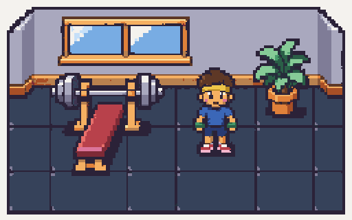 | 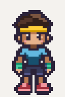 |

## Strips and loops

The game PNGs are 128×48: four 32×48 frames from left to right, transparent
backgrounds, binary alpha. Review strips are exact nearest-neighbor 4× copies
(512×192), and GIF frames are 4× (128×192), on a cream review background.
Side sprites face **right**; the viewer mirrors them when facing left.

| Asset | Strip at 4× | Loop at 4× |
| --- | --- | --- |
| [`idle_down`](../../../assets/characters/build-1/idle_down.png) | 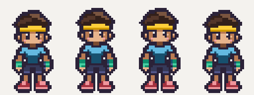 |  |
| [`idle_up`](../../../assets/characters/build-1/idle_up.png) | 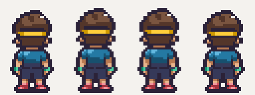 | 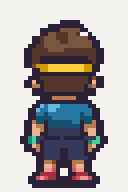 |
| [`idle_side`](../../../assets/characters/build-1/idle_side.png) | 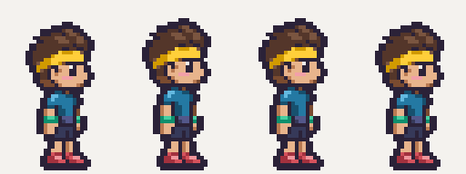 | 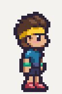 |
| [`walk_down`](../../../assets/characters/build-1/walk_down.png) | 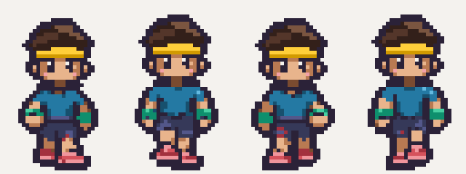 | 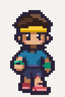 |
| [`walk_up`](../../../assets/characters/build-1/walk_up.png) | 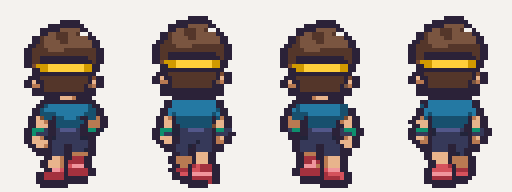 | 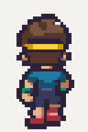 |
| [`walk_side`](../../../assets/characters/build-1/walk_side.png) | 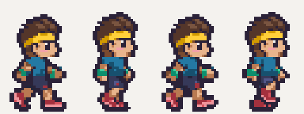 | 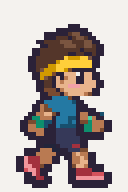 |

## Identity, motion and cleanup

- Front idle frame 1 is pixel-identical to the approved character reference.
  The front idle cycle uses the approved pixels with a one-pixel inhale on
  frames 2–3 and held rest poses on frames 1 and 4.
- Rear and right-profile keyframes came from their generated strips. Each
  direction's head is reused in its walk cycle to prevent frame-to-frame
  changes in face, hair, outline and head size. Head offsets are
  `[0, -1, -1, 0]` for idles and `[0, -1, 0, -1]` for walks.
- Walks retain four distinct generated leg/arm poses. Idles deliberately hold
  two breathing poses across four game frames. No other builds or actions
  were generated.
- Approximate generated hues were constrained to the unchanged body-part
  ramps: hair, skin, shirt, shorts, shoes, headband and wristbands. Cream and
  blush occur on visible faces only; back views have neither. Shoe highlights
  and soles use the shoe ramp. Thin exterior contours were strengthened.
- Large source exports were first normalized to native frame grids, then
  registered to the approved character and exported as exact 8× magenta
  staging strips before the required final pixelize pass. Raw sources and
  local cleanup helpers remain ignored under `art/raw/batch-2/`.

Final commands, from the repository root:

```bash
for name in idle_down idle_up idle_side walk_down walk_up walk_side; do
  pnpm pixelize strip "art/raw/batch-2/animations/char.build-1.$name.grid8.png" \
    --frames 4 --frame 32x48 --scale 8 --palette character \
    --out "assets/characters/build-1/$name.png" || exit
  pnpm pixelize check "assets/characters/build-1/$name.png" \
    --palette character --size 128x48 || exit
done
pnpm assets:status
```

## Validation and warnings

**Pixelize warnings: none for all six final strips.** All size, palette,
magenta and binary-transparency checks passed. All 24 frames have their
lowest solid pixel at **zero-based row 46**, matching the approved PNG and
the manifest's `[16, 46]` anchor; row 47 is clear. This follows the requested
row and reference, rather than the guide's inconsistent “two empty rows” wording.
No horizontal correction was needed after the final pixelize pass.

Head pixels were checked against the corresponding direction's keyframe at
the documented one-pixel offsets. Every walk has four distinct frames; each
idle has four frames with intentional breathing holds. Preview PNGs and GIF
decodes preserve the source colors exactly, without dithering.

Idles run at 6 fps in game. GIF delays are `[170, 160, 170, 170]` ms (670 ms
per loop, the nearest practical GIF timing); the GIF encoder merges the two
identical inhale holds without changing playback. Walk GIFs have four 100 ms
frames (10 fps, 400 ms per loop). All six GIFs loop indefinitely.

- `pnpm assets:status`: **7/127** first-version assets present, including all
  six batch-2 strips; only generated status files changed alongside the art.
- `pnpm test`: **82 passed** (59 server, 17 viewer, 6 pixelize).
- `pnpm typecheck`: shared, server, viewer and pixelize passed.
- Viewer production build passed.
- Chromium loaded all six through the actual `SpriteBank` as real art, checked
  dimensions/FPS/frame sequencing and all 24 foot baselines, and rendered the
  strips without page errors.

No application code, tests, source palettes, asset definitions, dependency
declarations or lockfile were changed.
