# Batch 3: Noodle, Buff and Maxxed idle and walk animations

Adds 18 strips: idle and walk in down, up and right-facing side views for builds 0, 2 and 3. Each production PNG is 128×48, containing four 32×48 frames with transparent backgrounds. Started from `main` at `77b324e`, which approves all three body references.

## All four builds moving together at 4×

Left to right: **Noodle (0), approved Toned (1), Buff (2), Maxxed (3)**. All four use the same playback rate and head-bob phase.

| Front walk | Right-facing walk |
| --- | --- |
| 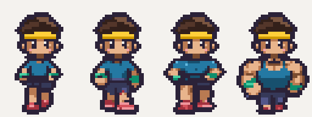 | 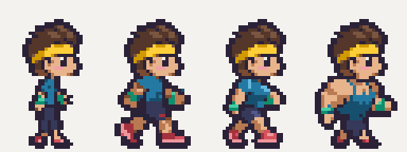 |

Additional comparisons: [front idle](all-builds-idle_down.gif), [rear idle](all-builds-idle_up.gif), [right idle](all-builds-idle_side.gif), [rear walk](all-builds-walk_up.gif).

## Individual strips and loops

Strip PNGs are exact nearest-neighbour 4× copies (512×192); individual looping GIF frames are 4× (128×192). Cream is only the review background. Native game PNGs retain binary transparency. Side views face right and work when mirrored by the viewer.

### Noodle — build 0

[Approved standing reference](../../reference/character-build-0.png):

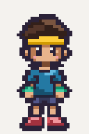

| Asset | Strip at 4× | Loop at 4× |
| --- | --- | --- |
| [`idle_down`](../../../assets/characters/build-0/idle_down.png) | 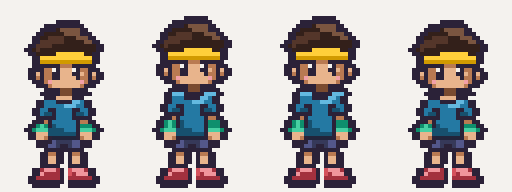 |  |
| [`idle_up`](../../../assets/characters/build-0/idle_up.png) | 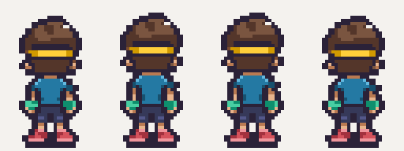 | 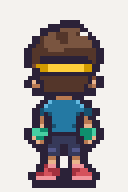 |
| [`idle_side`](../../../assets/characters/build-0/idle_side.png) | 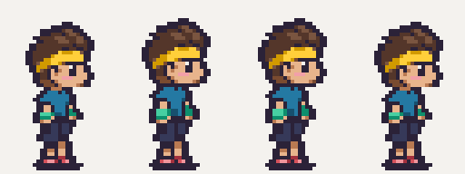 | 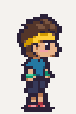 |
| [`walk_down`](../../../assets/characters/build-0/walk_down.png) | 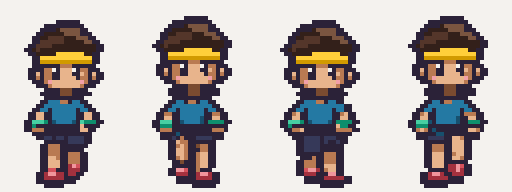 | 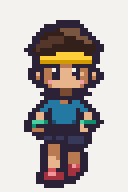 |
| [`walk_up`](../../../assets/characters/build-0/walk_up.png) | 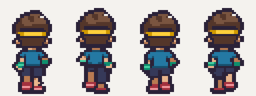 | 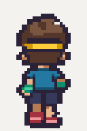 |
| [`walk_side`](../../../assets/characters/build-0/walk_side.png) | 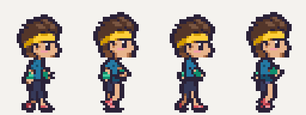 | 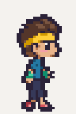 |

2× comparison against the approved style tile. Right column rows, top to bottom: `idle_down`, `idle_up`, `idle_side`, `walk_down`, `walk_up`, `walk_side`. Each row contains all four frames at exactly 2×.

| Approved style tile — 2× | Noodle strips — 2× |
| --- | --- |
| 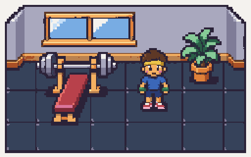 | 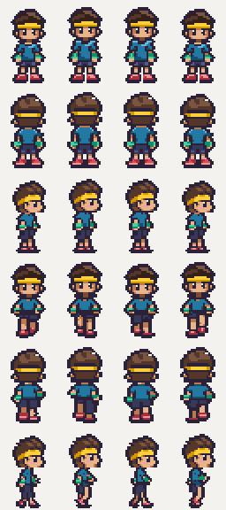 |

### Buff — build 2

[Approved standing reference](../../reference/character-build-2.png):

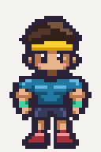

| Asset | Strip at 4× | Loop at 4× |
| --- | --- | --- |
| [`idle_down`](../../../assets/characters/build-2/idle_down.png) | 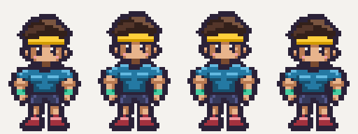 |  |
| [`idle_up`](../../../assets/characters/build-2/idle_up.png) | 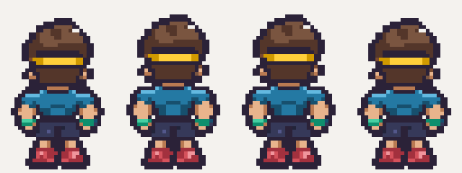 | 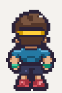 |
| [`idle_side`](../../../assets/characters/build-2/idle_side.png) | 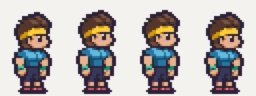 | 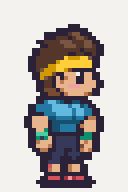 |
| [`walk_down`](../../../assets/characters/build-2/walk_down.png) | 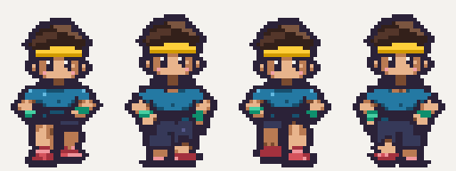 | 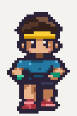 |
| [`walk_up`](../../../assets/characters/build-2/walk_up.png) | 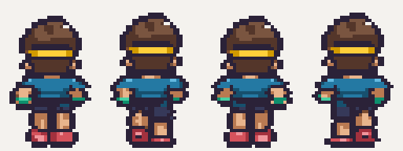 | 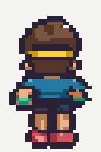 |
| [`walk_side`](../../../assets/characters/build-2/walk_side.png) | 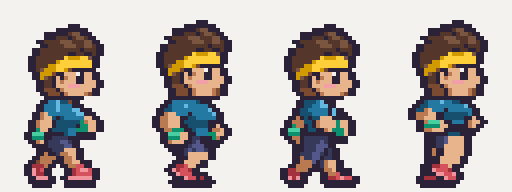 | 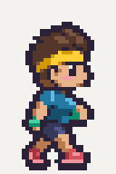 |

2× comparison against the approved style tile. Right column rows, top to bottom: `idle_down`, `idle_up`, `idle_side`, `walk_down`, `walk_up`, `walk_side`. Each row contains all four frames at exactly 2×.

| Approved style tile — 2× | Buff strips — 2× |
| --- | --- |
|  | 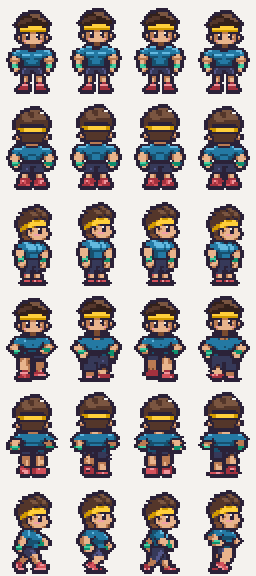 |

### Maxxed — build 3

[Approved standing reference](../../reference/character-build-3.png):

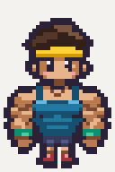

| Asset | Strip at 4× | Loop at 4× |
| --- | --- | --- |
| [`idle_down`](../../../assets/characters/build-3/idle_down.png) | 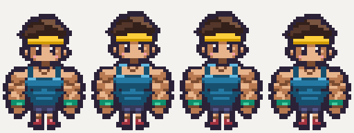 |  |
| [`idle_up`](../../../assets/characters/build-3/idle_up.png) | 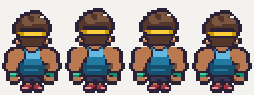 | 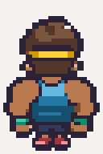 |
| [`idle_side`](../../../assets/characters/build-3/idle_side.png) | 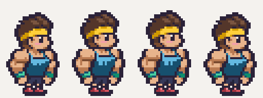 | 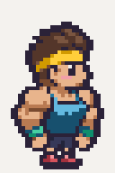 |
| [`walk_down`](../../../assets/characters/build-3/walk_down.png) | 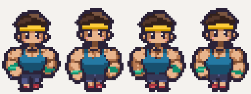 | 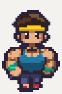 |
| [`walk_up`](../../../assets/characters/build-3/walk_up.png) | 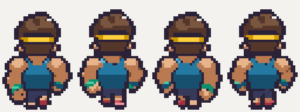 | 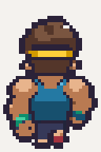 |
| [`walk_side`](../../../assets/characters/build-3/walk_side.png) | 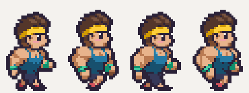 | 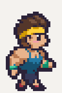 |

2× comparison against the approved style tile. Right column rows, top to bottom: `idle_down`, `idle_up`, `idle_side`, `walk_down`, `walk_up`, `walk_side`. Each row contains all four frames at exactly 2×.

| Approved style tile — 2× | Maxxed strips — 2× |
| --- | --- |
|  | 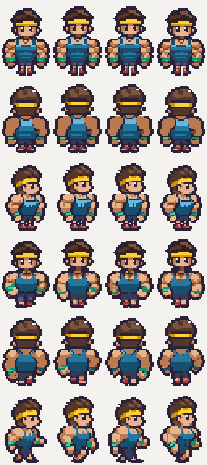 |

## References, motion and cleanup

- Every generation attached `art/reference/style-tile.png`, that build's approved `art/reference/character-build-<n>.png`, the matching approved strip from `assets/characters/build-1/`, and the approved Toned standing reference. One strip was generated per image, on magenta. Raw images and local helpers remain ignored under `art/raw/batch-3/animations/`.
- Front idle frame 1 is pixel-identical to each approved body reference. Front idles retain those approved pixels with the same one-pixel upper-body inhale used by Toned. Rear and side keyframes come from the generated bodies.
- Each frame's head area is copied from its corresponding approved Toned frame. This preserves the exact shared head, face, hair, band and placement, including the rear view and right-facing profile. Idle head offsets are `[0, -1, -1, 0]`; walk offsets are `[0, -1, 0, -1]`.
- Idles use four frames at **6 fps**, with held rest/inhale poses matching Toned. Walks use four distinct contact/passing frames at **10 fps**. Every frame's lowest occupied pixel is **zero-based row 46**, matching the references and `[16, 46]` anchor; row 47 stays clear.
- Source exports were normalized to the native grids with pixelize, registered to the approved proportions and constrained to body-part colour ramps. Palette drift on limbs/shoe highlights was corrected, small wristbands retained and thin exterior contours strengthened. No hair, headband, eye-shine, cheek or metal colours remain in the new bodies.
- Exact 8× magenta staging strips were then passed through the required pixelize command. A one-pixel horizontal registration correction on Buff `walk_up` frame 2 reverses pixelize's bounding-box centring so the head stays aligned with Toned. No feet were shifted off row 46.

```bash
for build in 0 2 3; do
  for name in idle_down idle_up idle_side walk_down walk_up walk_side; do
    pnpm pixelize strip "art/raw/batch-3/animations/char.build-$build.$name.grid8.png" \
      --frames 4 --frame 32x48 --scale 8 --palette character \
      --out "assets/characters/build-$build/$name.png" || exit
    pnpm pixelize check "assets/characters/build-$build/$name.png" \
      --palette character --size 128x48 || exit
  done
done
pnpm assets:status
```

## Validation and warnings

- **Pixelize cleanup warnings: none. Pixelize check warnings: none.** All 18 final strips pass size, palette, magenta and binary-alpha checks.
- Pixel audit covers all **72 new frames**: feet at row 46, unchanged Toned head pixels per phase, clear canvas edges, visible shoes and wristbands, no head-only or metal colours in bodies, two intentional idle poses and four distinct walk poses.
- All 4× and 2× PNG previews preserve exact source colours. All **24 GIFs** (18 individual and six all-build comparisons) were decoded and compared back to the source pixels at every phase, without dithering.
- GIFs loop forever. Walk delays are four 100 ms frames (400 ms total). Idle delays match the existing Toned previews: `[170, 160, 170, 170]` ms (670 ms total, the nearest practical GIF timing); identical inhale holds may be merged by the encoder without changing playback.
- `pnpm assets:status`: **25/127** first-version assets present. Only the 18 requested asset statuses changed; the generated asset list and manifest were regenerated by the tool.
- `pnpm test`: **82 passed**. `pnpm typecheck`: all four packages pass.
- Viewer production build passes. Chromium loads all **24** character strips as real art through the actual `SpriteBank`, checks FPS, frame sequencing and all **96** foot baselines, and renders the four builds together.

Approved reference images, Toned production strips, palettes, asset definitions, application code, dependencies and lockfile are unchanged.
