# Batch 4: floor and wall tiles

Adds all 11 batch-4 tiles at their listed sizes. Started from `main` at `501ebd4`, which includes the approved character animations. Every generation attached the unchanged `art/reference/style-tile.png`; one tile was generated per image.

The dominant rubber field is the reference's `#36425A`, the wall field is `#A9A8BE`, and the warm skirting/window trim follows the approved palette. Floorboards run left to right; rubber and foam joints form two-pixel lines when tiles meet.

## Compare with the approved style at 2×

The floor overview contains six separate 3×3 repeats, all at exactly 2×. Top row: rubber 1, rubber 2, wood 1. Bottom row: wood 2, pink mat, teal mat.

| Approved style tile — 2× | New floor repeats — 2× |
| --- | --- |
| 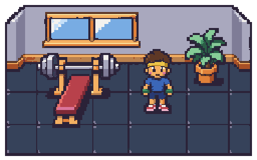 | 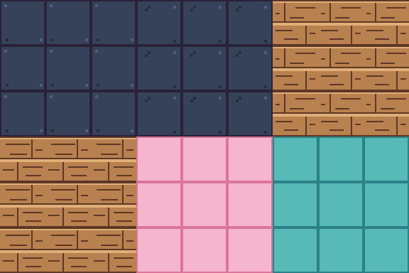 |

| Approved style tile — 2× | Joined wall pieces — 2× |
| --- | --- |
|  | 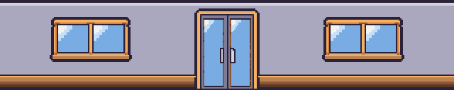 |

| Approved style tile — 2× | Side wall and front ledge, each repeated 3×3 at 2× |
| --- | --- |
|  | 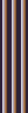 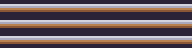 |

## Every tile repeated 3×3 at 2×

Every preview below contains nine unmodified copies of its production PNG, placed directly next to one another without gutters, mirroring, added seam lines or filtering. Preview pixels use exact nearest-neighbour 2× scaling. Native tiles are fully opaque, with no magenta or half-transparent pixels.

| Native tile and size | 3×3 repeat at 2× |
| --- | --- |
| [`tile.floor_rubber_1`](../../../assets/tiles/floor_rubber_1.png) — 32×32 | 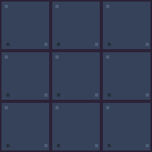 |
| [`tile.floor_rubber_2`](../../../assets/tiles/floor_rubber_2.png) — 32×32 | 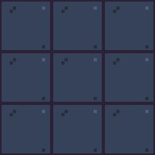 |
| [`tile.floor_wood_1`](../../../assets/tiles/floor_wood_1.png) — 32×32 | 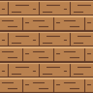 |
| [`tile.floor_wood_2`](../../../assets/tiles/floor_wood_2.png) — 32×32 | 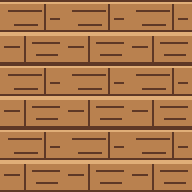 |
| [`tile.floor_mat_pink`](../../../assets/tiles/floor_mat_pink.png) — 32×32 | 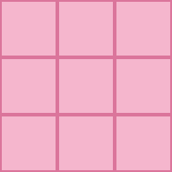 |
| [`tile.floor_mat_teal`](../../../assets/tiles/floor_mat_teal.png) — 32×32 | 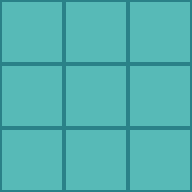 |
| [`tile.wall_back`](../../../assets/tiles/wall_back.png) — 32×64 | 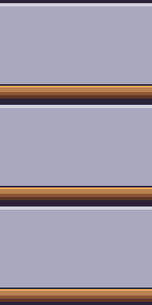 |
| [`tile.wall_window`](../../../assets/tiles/wall_window.png) — 64×64 | 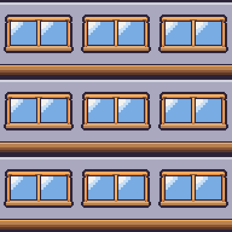 |
| [`tile.wall_door`](../../../assets/tiles/wall_door.png) — 64×64 | 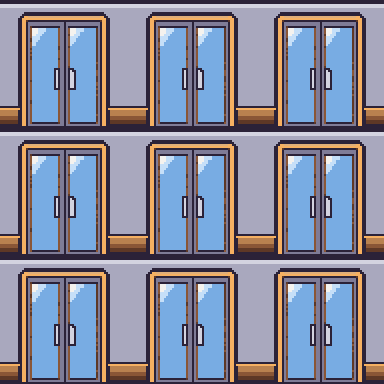 |
| [`tile.wall_side`](../../../assets/tiles/wall_side.png) — 8×32 |  |
| [`tile.wall_front`](../../../assets/tiles/wall_front.png) — 32×8 |  |

Back, window and door walls join horizontally; side walls repeat vertically; the front ledge repeats horizontally, as listed in `art/ASSETS.md`. The wall 3×3 previews show complete wall-height bands with their caps and skirting. Floors repeat in both directions.

## Mixed-tile seam checks

Both ordered combinations of each rubber/wood pair were checked along both axes. All nine ordered combinations of plain/window/door wall edges were checked horizontally. The side-wall and front-ledge cap profiles also match.

| Alternating rubber variants — 3×3 at 2× | Alternating wood variants — 3×3 at 2× |
| --- | --- |
| 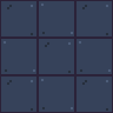 | 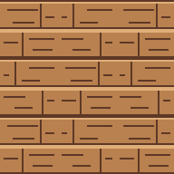 |


[View the actual renderer's room at 2×](room-context@2x.png). Wall-mounted props in that context image are the existing placeholders; the 11 new assets are the floor and wall tiles.

## Generation and cleanup

Raw exports and local helpers remain ignored under `art/raw/batch-4/`. The generated material shapes were normalized to native grids with pixelize and constrained to subsets of the unchanged environment palette. Cleanup retained sparse 2×2 rubber flecks, aligned plank-edge profiles, restored thin foam joints, matched architectural cap/skirting bands and strengthened exterior window/door contours.

All 11 tiles were then exported as exact 8× staging images and cleaned with `pnpm pixelize tile ... --scale 8`. Tile mode fits the input to `--size`; exact 8× staging makes the final reduction uniformly 8× for every asset. No CLI or palette changes were needed.

```bash
# Use each tile's listed dimensions: floors 32x32, back 32x64,
# window/door 64x64, side 8x32, front 32x8.
pnpm pixelize tile art/raw/batch-4/tile.floor_rubber_1.grid8.png \
  --size 32x32 --palette environment --scale 8 \
  --out assets/tiles/floor_rubber_1.png
pnpm pixelize check assets/tiles/floor_rubber_1.png \
  --palette environment --size 32x32
# The same commands were run for all 11 tiles at their listed sizes.
pnpm assets:status
```

## Validation and warnings

- **Pixelize cleanup warnings: none. Pixelize check warnings: none.** All 11 production PNGs pass their exact size, palette, magenta and alpha checks; all final cleanup commands report scale 8.
- Visually inspected every final 3×3 repeat at 2×, the mixed floor repeats and the joined wall run against the approved style tile.
- [Pixel and seam report](checks.json): **zero mismatched pixels on both opposing edges of every tile**; zero mismatches for mixed rubber/wood variants and all nine ordered back-wall pairings. All 99 preview copies preserve the production pixels exactly.
- `pnpm assets:status`: **36/127** first-version assets present; only the 11 requested tile statuses changed. `art/ASSETS.md` and `assets/manifest.json` were regenerated by the tool.
- `pnpm test`: **82 passed** (59 server, 17 viewer, 6 pixelize). `pnpm typecheck`: all four packages pass. Viewer production build passes.
- Chromium loads all 11 tiles through the actual `SpriteBank` as real art, checks dimensions/opacity/opposing edges, renders all 99 repeated tile copies, and paints the 768×448 room through the actual `GymRenderer`. **35 real sprites** total (24 character strips plus 11 tiles), with no page exceptions.

Approved references, character strips, palettes, asset definitions, application code, dependencies and lockfile are unchanged.
