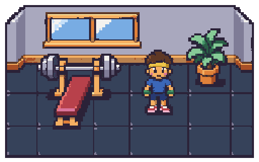
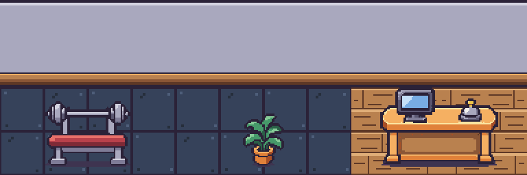
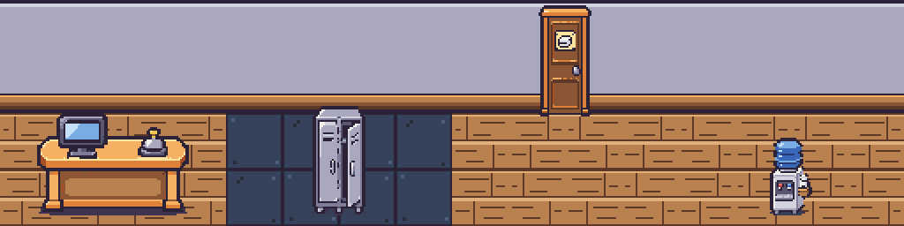
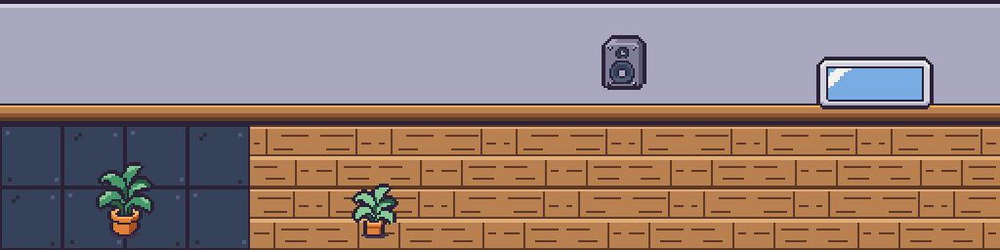
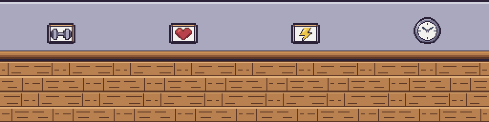
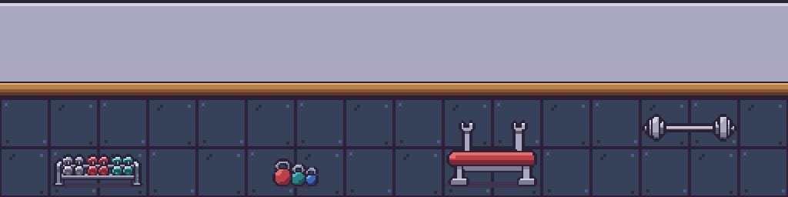
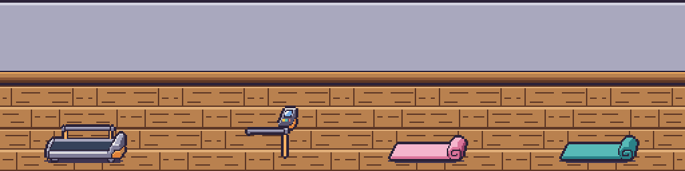
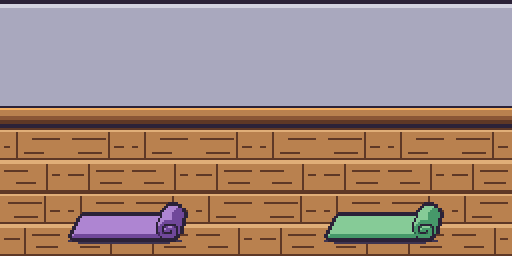
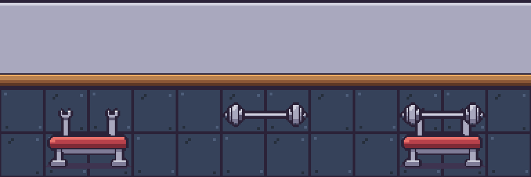
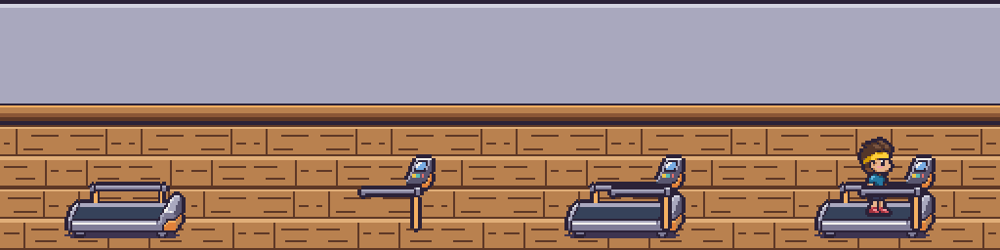

# Batch 5: v1 props and machines

Adds all **22 v1 props** at their listed sizes, replacing their placeholders automatically. Started from `main` at `8f2ef08`, which includes the approved batch 4 tiles. Every generation attached the unchanged `art/reference/style-tile.png`; each prop was generated on its own magenta image. The bench uses the approved red upholstery/grey metal, and the plants retain the approved arched leaves, terracotta pots and chunky outlines.

## Style comparison at 2×

Featured strip, left to right: assembled bench, large plant, reception desk. The backgrounds are the actual unchanged batch 4 floor and wall PNGs, with every prop and backdrop pixel shown at exactly 2×.

| Approved style tile — 2× | Featured props on batch 4 tiles — 2× |
| --- | --- |
|  |  |

## All props at 2× on floor and wall strips

[Open one continuous strip containing all 22 props at 2×](all-props-strip@2x.png), or [the full gallery at 2×](all-props-grid@2x.png). Shorter strips below make the same pixels easier to inspect on mobile. Each slot contains actual 32-pixel batch 4 tiles; backgrounds and sprites use nearest-neighbour 2× scaling with no filtering or palette changes.

Left to right: `front_desk`, `lockers`, `locker_room_door`, `water_cooler`.



Left to right: `plant_big`, `plant_small`, `speaker`, `mirror`.



Left to right: `poster_dumbbell`, `poster_heart`, `poster_bolt`, `clock`.



Left to right: `dumbbell_rack`, `kettlebells`, `bench_back`, `bench_bar`.



Left to right: `treadmill_back`, `treadmill_front`, `yoga_mat_pink`, `yoga_mat_teal`.



Left to right: `yoga_mat_purple`, `yoga_mat_green`.



## Individual files

The per-prop floor/wall previews are 256×256, preserving 2× sprite pixels. Wall props sit on the wall; floor props stand on wood or rubber. The resting bar and treadmill foreground are shown in their intended elevated positions, with their empty areas revealing the tiles behind them.

| Asset | Native size | Preview on batch 4 tiles — 2× |
| --- | --- | --- |
| [`prop.front_desk`](../../../assets/props/front_desk.png) | 96×64 | [Open preview](front_desk.on-tiles@2x.png) · [transparent sprite](front_desk@2x.png) |
| [`prop.lockers`](../../../assets/props/lockers.png) | 32×64 | [Open preview](lockers.on-tiles@2x.png) · [transparent sprite](lockers@2x.png) |
| [`prop.locker_room_door`](../../../assets/props/locker_room_door.png) | 32×64 | [Open preview](locker_room_door.on-tiles@2x.png) · [transparent sprite](locker_room_door@2x.png) |
| [`prop.water_cooler`](../../../assets/props/water_cooler.png) | 32×48 | [Open preview](water_cooler.on-tiles@2x.png) · [transparent sprite](water_cooler@2x.png) |
| [`prop.plant_big`](../../../assets/props/plant_big.png) | 32×48 | [Open preview](plant_big.on-tiles@2x.png) · [transparent sprite](plant_big@2x.png) |
| [`prop.plant_small`](../../../assets/props/plant_small.png) | 32×32 | [Open preview](plant_small.on-tiles@2x.png) · [transparent sprite](plant_small@2x.png) |
| [`prop.speaker`](../../../assets/props/speaker.png) | 32×32 | [Open preview](speaker.on-tiles@2x.png) · [transparent sprite](speaker@2x.png) |
| [`prop.mirror`](../../../assets/props/mirror.png) | 64×48 | [Open preview](mirror.on-tiles@2x.png) · [transparent sprite](mirror@2x.png) |
| [`prop.poster_dumbbell`](../../../assets/props/poster_dumbbell.png) | 32×32 | [Open preview](poster_dumbbell.on-tiles@2x.png) · [transparent sprite](poster_dumbbell@2x.png) |
| [`prop.poster_heart`](../../../assets/props/poster_heart.png) | 32×32 | [Open preview](poster_heart.on-tiles@2x.png) · [transparent sprite](poster_heart@2x.png) |
| [`prop.poster_bolt`](../../../assets/props/poster_bolt.png) | 32×32 | [Open preview](poster_bolt.on-tiles@2x.png) · [transparent sprite](poster_bolt@2x.png) |
| [`prop.clock`](../../../assets/props/clock.png) | 32×32 | [Open preview](clock.on-tiles@2x.png) · [transparent sprite](clock@2x.png) |
| [`prop.dumbbell_rack`](../../../assets/props/dumbbell_rack.png) | 64×32 | [Open preview](dumbbell_rack.on-tiles@2x.png) · [transparent sprite](dumbbell_rack@2x.png) |
| [`prop.kettlebells`](../../../assets/props/kettlebells.png) | 32×32 | [Open preview](kettlebells.on-tiles@2x.png) · [transparent sprite](kettlebells@2x.png) |
| [`prop.bench_back`](../../../assets/props/bench_back.png) | 64×48 | [Open preview](bench_back.on-tiles@2x.png) · [transparent sprite](bench_back@2x.png) |
| [`prop.bench_bar`](../../../assets/props/bench_bar.png) | 64×24 | [Open preview](bench_bar.on-tiles@2x.png) · [transparent sprite](bench_bar@2x.png) |
| [`prop.treadmill_back`](../../../assets/props/treadmill_back.png) | 64×48 | [Open preview](treadmill_back.on-tiles@2x.png) · [transparent sprite](treadmill_back@2x.png) |
| [`prop.treadmill_front`](../../../assets/props/treadmill_front.png) | 64×48 | [Open preview](treadmill_front.on-tiles@2x.png) · [transparent sprite](treadmill_front@2x.png) |
| [`prop.yoga_mat_pink`](../../../assets/props/yoga_mat_pink.png) | 64×32 | [Open preview](yoga_mat_pink.on-tiles@2x.png) · [transparent sprite](yoga_mat_pink@2x.png) |
| [`prop.yoga_mat_teal`](../../../assets/props/yoga_mat_teal.png) | 64×32 | [Open preview](yoga_mat_teal.on-tiles@2x.png) · [transparent sprite](yoga_mat_teal@2x.png) |
| [`prop.yoga_mat_purple`](../../../assets/props/yoga_mat_purple.png) | 64×32 | [Open preview](yoga_mat_purple.on-tiles@2x.png) · [transparent sprite](yoga_mat_purple@2x.png) |
| [`prop.yoga_mat_green`](../../../assets/props/yoga_mat_green.png) | 64×32 | [Open preview](yoga_mat_green.on-tiles@2x.png) · [transparent sprite](yoga_mat_green@2x.png) |

## Split-machine checks at 2×

Bench panels: empty back, separate barbell, assembled resting bench. `bench_back` has empty holders and no barbell. The barbell PNG contains only plates and shaft, without a floor shadow. At the existing renderer anchors, the bar's canvas sits 4 pixels above the back canvas; its shaft meets both holder cups on row 9 of the back canvas. The renderer hides the resting bar when the bench is in use.



Treadmill panels: back, foreground only, assembled machine, static occlusion check. The back contains the deck/belt and far-side structure. The foreground contains only the right-hand console and near rail/support: its left area, space beneath the handrail, and rows 45–47 are transparent. Both 64×48 layers retain the existing `[32, 46]` anchor.



The static occlusion check reuses approved Toned `idle_side` frame 1: 81 reference pixels are covered by the near rail/console and 465 remain visible. It checks the layer order and opening; action animations belong to batch 6.

[View the actual renderer's room at 2×](room-context@2x.png). Its existing staff placeholder remains in place; the floor/wall and prop art are loaded from their real PNGs.

## Shadows, grid and cleanup

- The 13 floor-standing props have small flat `#3E3450` contact shadows. The seven wall props and two separate overlays have zero floor-shadow pixels. Shadows use one solid palette colour and binary alpha.
- Raw outputs and local helpers remain ignored under `art/raw/batch-5/`. Large generated exports were normalized to native grids with pixelize; material colours, thin exterior contours and contact shadows were cleaned before exporting exact 8× magenta staging images.
- All 22 final PNGs were cleaned with `pnpm pixelize sprite ... --scale 8`, then checked against the unchanged environment palette and their exact listed sizes. No text appears in any prop; posters use icons and the clock has hands/ticks without numerals.
- Sprite mode bottom-centres its visible bounds. Integer registration restores the overlays' intended full-canvas coordinates afterward: the resting bar moved up 2 pixels, and treadmill foreground moved right 11/up 3 pixels. These translations preserve every cleaned pixel; palette, size and transparency checks were repeated afterward. The [pixel audit](checks.json) records bounds, hashes, shadow counts and initial registration offsets.

```bash
# Each prop uses its own listed size from art/ASSETS.md.
pnpm pixelize sprite art/raw/batch-5/prop.bench_back.grid8.png \
  --size 64x48 --palette environment --scale 8 \
  --out assets/props/bench_back.png
pnpm pixelize check assets/props/bench_back.png \
  --palette environment --size 64x48
# The same cleanup and check commands were run for all 22 v1 props.
pnpm assets:status
```

## Validation and warnings

- **Pixelize cleanup warnings: none. Pixelize check warnings: none.** Every final PNG has the listed dimensions, only environment-palette colours, binary transparency and no magenta.
- All 22 native sprites and 2× floor/wall previews were inspected against the approved style tile. Preview foreground pixels were compared back to the production PNGs exactly.
- Split-layer masks pass: no bar in `bench_back`, no shadow on `bench_bar`, and no belt/base/feet/ground shadow in `treadmill_front`. Both holder contacts and the runner opening were checked.
- The four `later` props remain absent: `squat_rack`, `leg_press`, `rower`, `sparring_ring`.
- `pnpm assets:status`: **58/127** first-version assets present. Only the 22 requested prop statuses changed; `art/ASSETS.md` and `assets/manifest.json` were regenerated by the tool.
- `pnpm test`: **82 passed** (59 server, 17 viewer, 6 pixelize). `pnpm typecheck`: all four packages pass. Viewer production build passes.
- Chromium loads all **22 props** through the actual `SpriteBank`, verifies dimensions/anchors/transparency/shadows and skipped later props, and renders the room through the actual `GymRenderer`. The renderer checks show two resting-bench layers, one occupied-bench layer and two treadmill layers. **57 real sprites** loaded total; zero page exceptions.

Approved references, batch 4 tiles, character strips, palettes, asset definitions, application code, dependencies and lockfile are unchanged.
