# Batch 6: all four builds on their machines

Adds the 18 remaining action strips for **Noodle (0), Buff (2) and Maxxed (3)**, completing all 24 batch 6 strips. Also repairs Toned's raised-arm inner outlines in yoga_tree and the underside in bench_fail. Started from main at fe0ea79, which contains the approved Toned actions.

Each generation attached the approved style tile, that build's character reference, the matching build 1 strip, its integer 8× view and the Toned reference. One strip per magenta image. The approved references, palette, props, tiles, frame metadata and application code remain unchanged.

**Every image below has columns in this order: Noodle (0) · Toned (1) · Buff (2) · Maxxed (3).** The body changes; approved Toned head material pixels, barbell pixels and phase positions are retained. Noodle has thin arms/a loose tee; Buff has a broader chest/muscular arms; Maxxed has huge bare arms/a tank top and tiny legs.

## Style comparison at 2×

| Approved style tile | All four builds on their machines |
| --- | --- |
| 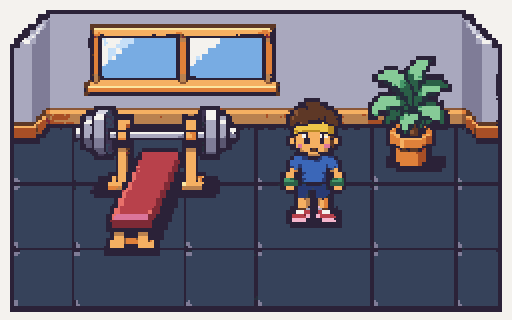 | 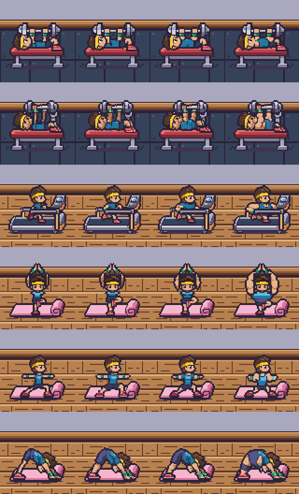 |

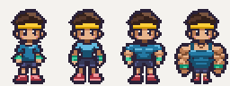

[Open the looping all-actions overview](all-actions.four-builds@2x.gif). Each individual GIF below is smaller for mobile viewing. PNGs and GIFs have exact nearest-neighbour 2× pixels; open the image to view the intrinsic size.

## Side-by-side strips and loops at 2×

### bench_press — 4 frames at 8 fps

Noodle · Toned · Buff · Maxxed. PNG rows show frames 1 through 4; the GIF plays the four builds together.

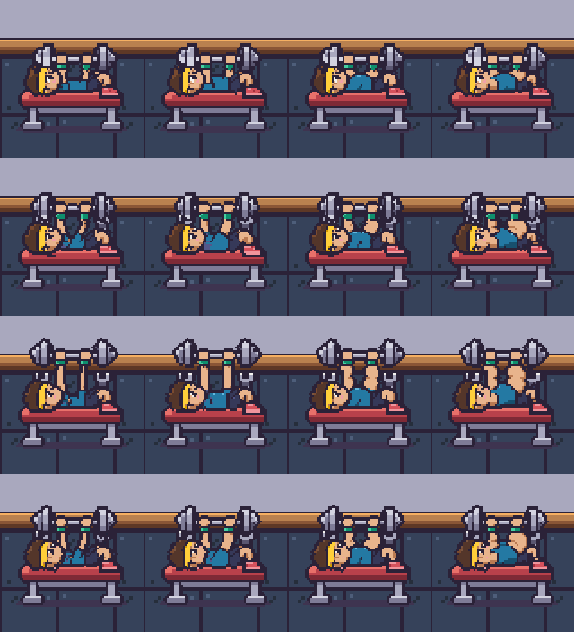

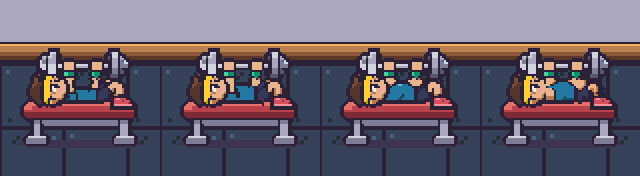

### bench_fail — 4 frames at 8 fps

Noodle · Toned · Buff · Maxxed. PNG rows show frames 1 through 4; the GIF plays the four builds together.

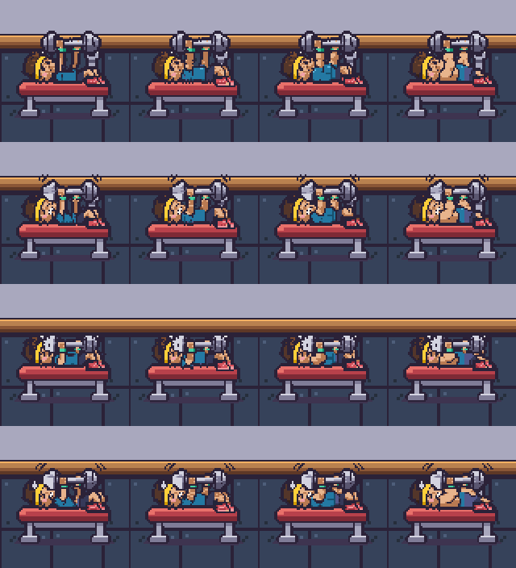

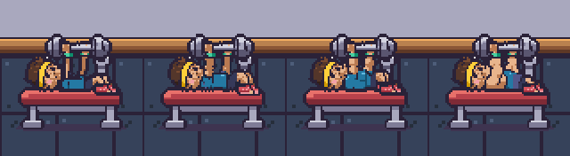

### run — 4 frames at 12 fps

Noodle · Toned · Buff · Maxxed. PNG rows show frames 1 through 4; the GIF plays the four builds together.

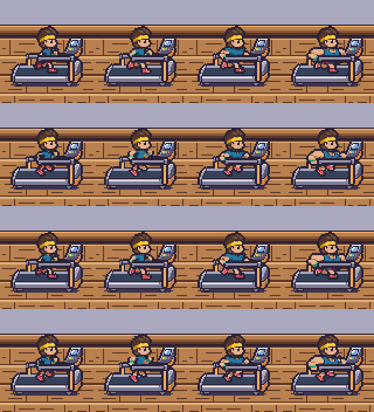

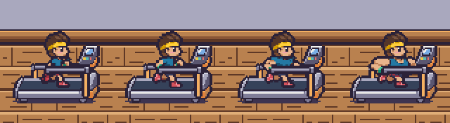

### yoga_tree — 2 frames at 3 fps

Noodle · Toned · Buff · Maxxed. PNG rows show frames 1 through 2; the GIF plays the four builds together.

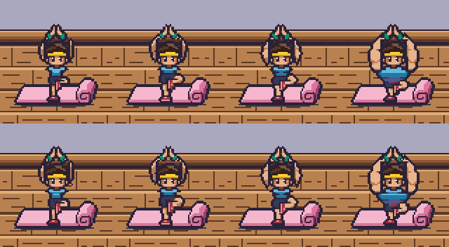

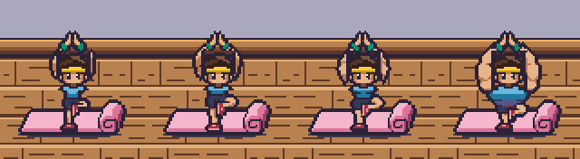

### yoga_warrior — 2 frames at 3 fps

Noodle · Toned · Buff · Maxxed. PNG rows show frames 1 through 2; the GIF plays the four builds together.

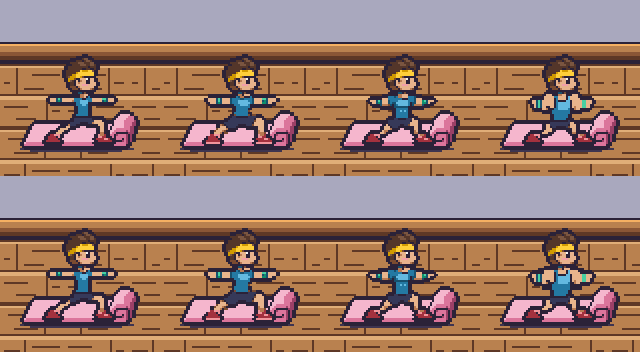

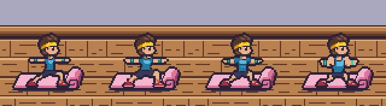

### yoga_dog — 2 frames at 3 fps

Noodle · Toned · Buff · Maxxed. PNG rows show frames 1 through 2; the GIF plays the four builds together.

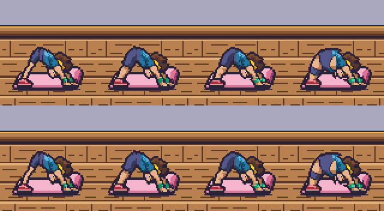

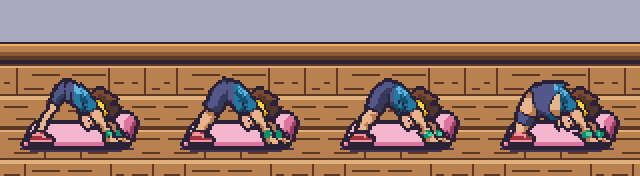

## Toned outline repairs

These comparisons show the original strip on top and the corrected strip below, at 2×. Every changed pixel becomes ink (#2B2238); all other pixels stay byte-identical.

- **yoga_tree:**70 ink repairs across both frames close the inside edges of both raised arms beside the head and at the arm/head junctions.
- **bench_fail:**174 ink repairs across four frames close the underside from the head/neck through the torso and hips.

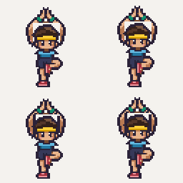

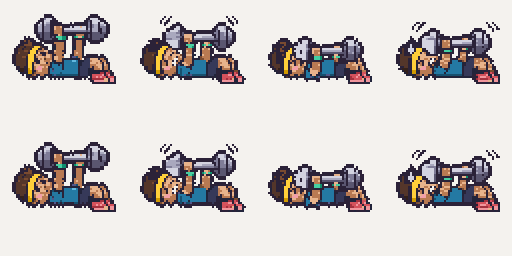

## Alignment and cleanup

Every frame remains 64×64, anchor (32,60). Bench press/fail have 4 frames at 8 fps, run 4 at 12 fps, each yoga pose 2 at 3 fps. Side views face right; bench heads face left. Bench sprites hold their own barbell and contain no bench. Running contains no treadmill; yoga contains no mat.

The anchor is the machine's floor point. Lying bodies meet the cushion around row 38, the runner contacts the raised belt on row 50, and yoga contacts remain on row 60. The composites use bench_back → actor, treadmill_back → actor → treadmill_front, and the mat's existing +2-pixel floor offset. Occupied benches hide the resting bench_bar.

All 20 new/repaired strips ran through:

`pnpm pixelize strip ... --frames N --frame 64x64 --anchor 32,60 --scale 8 --palette character`

Cleanup snaps body parts to their own ramps, preserves approved heads/equipment, closes silhouette outlines including negative spaces and lying-body undersides, and retains two-pixel shoe soles. Pixelize's crop/bottom-centre step is reversed with integer translations to restore the registered machine position. A byte comparison verifies every registered frame against its native grid after that translation.

## Warnings

The following 7 strip cleanups report the bounding-height heuristic:

| Asset | Exact pixelize warning |
| --- | --- |
| char.build-0.bench_press | Frame heights vary a lot (31, 36, 43, 38). The head may change size between frames. |
| char.build-0.bench_fail | Frame heights vary a lot (35, 34, 24, 31). The head may change size between frames. |
| char.build-1.bench_fail | Frame heights vary a lot (35, 34, 24, 31). The head may change size between frames. |
| char.build-2.bench_press | Frame heights vary a lot (31, 36, 43, 38). The head may change size between frames. |
| char.build-2.bench_fail | Frame heights vary a lot (35, 34, 24, 31). The head may change size between frames. |
| char.build-3.bench_press | Frame heights vary a lot (31, 36, 43, 38). The head may change size between frames. |
| char.build-3.bench_fail | Frame heights vary a lot (35, 34, 24, 31). The head may change size between frames. |

The moving barbell changes the full silhouette height. Approved head material pixels, barbell trajectory and support positions match the Toned guide; the frame grids and loops above show every phase. No oversized-frame or clipping warnings. Running and yoga produce no strip warnings. The unchanged Toned bench_press guide retains its earlier height warning, documented in the original batch 6 review.

All 20 final CLI pixelize checks pass with the expected strip dimensions, palette and binary transparency. The browser inspection emitted 24 Canvas2D readback performance advisories from repeated pixel comparisons; no runtime errors or failed requests. GIF timing rounds to 10ms increments; game animation uses the exact manifest FPS. The room screenshot includes the existing staff and sweat-effect placeholders from later batches.

## Validation

- Native audit: 24 strips/72 frames across all builds; each strip has distinct phases and its exact requested frame count and dimensions.
- All 54 new frames pass the two-pixel outline audit: no material pixel is within two cardinal steps of transparency. Raised-arm inner edges and lying-body undersides are included.
- Approved head material pixels and all held-bar metal pixels match the corresponding Toned frame; contact lines and planted yoga supports are fixed.
- All 20 new/repaired assets pass `pnpm pixelize check ... --palette character --size Wx64`; the native check also covers the four unchanged guides.
- `pnpm assets:status`: **82/127** v1 assets, exactly 18 new manifest presence flags.
- `pnpm test`: **82 passed**. `pnpm typecheck`: passed.
- Actual SpriteBank/viewer: 81 real runtime PNGs, all 24 action routes select real sprites with exact FPS/anchors; occupied bench and treadmill layering pass; changing only the shirt ramp changes only shirt pixels on all 24 strips.
- References, palettes, props, tiles, earlier idle/walk strips, the other four Toned actions, application code and dependencies remain unchanged.

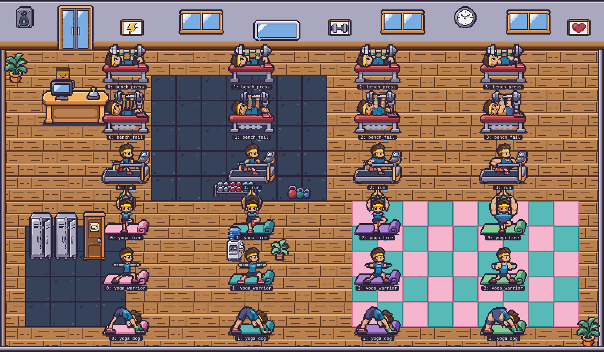

[Frame, outline, palette, registration, preview and browser audit](checks.json)
