# Batch 6: Toned on-machine animations

Adds the six build 1 actions from art/ASSETS.md: 18 frames in total. Started from `main` at e1f0b3e, including the approved batch 5 machines. Every generation attached the approved style tile, Toned character reference, bench_back, treadmill_back and yoga_mat_pink.

All action frames are 64×64 with anchor (32,60), binary transparency and the unchanged character palette. Bench strips contain the held barbell and actor; run/yoga strips contain the actor. Each part uses its own swap ramp. The upright heads reuse approved front/profile pixels, and yoga breathing keeps planted supports fixed.

## Style comparison at 2×

| Approved style tile | New actions on approved machines |
| --- | --- |
| 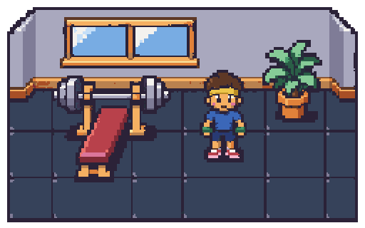 | 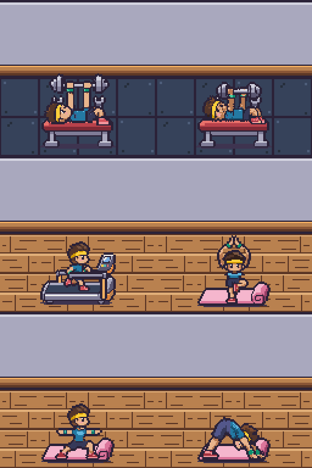 |

[Looping mobile overview](all-actions.on-machines@2x.gif). Grid order: bench press, bench fail; run, tree; warrior, dog. [Approved Toned reference at 2×](character-build-1@2x.png).

## Every strip on its machine at 2×

Each PNG shows all frames left to right on the unchanged batch 4 floor/wall and batch 5 prop; each GIF loops in place. Open the image for its full 2× pixel size.

### bench_press — 4 frames at 8fps

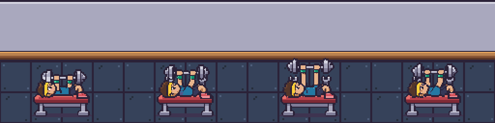

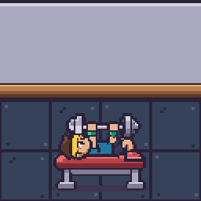

### bench_fail — 4 frames at 8fps

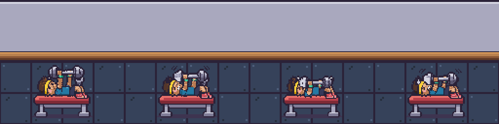

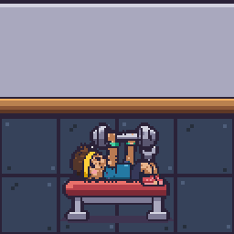

### run — 4 frames at 12fps

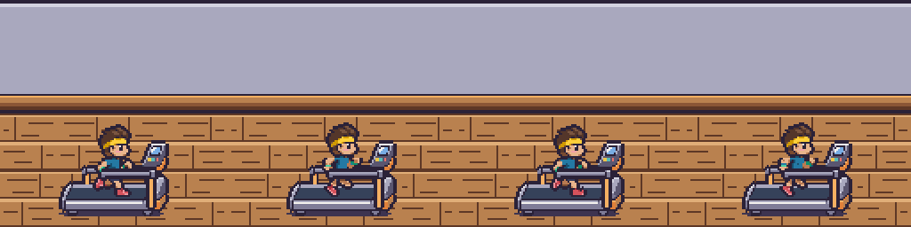

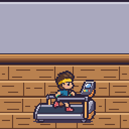

### yoga_tree — 2 frames at 3fps

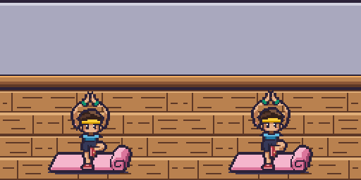

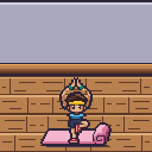

### yoga_warrior — 2 frames at 3fps

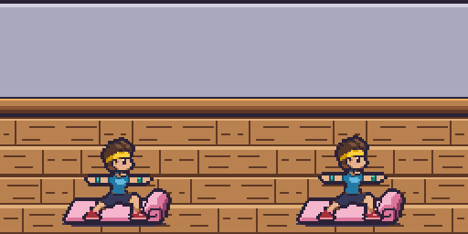

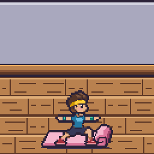

### yoga_dog — 2 frames at 3fps

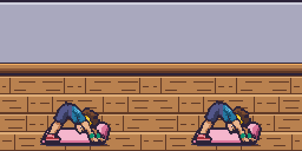

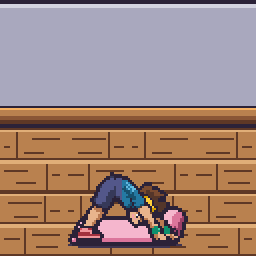

## Machine registration

The common (32,60) anchor is the machine's floor point. The bench cushion supports the lying body around action row 38; the runner's contact soles stay on row 50 over the raised belt; yoga supports stay on row 60. The bench preview uses bench_back with the actor's held bar; the resting bench_bar is hidden by the existing occupied-machine renderer. Running uses treadmill_back → actor → treadmill_front, preserving foreground occlusion. Yoga uses the renderer's mat offset of +2 pixels.

Pixelize crops and bottom-centres frames. Cleanup therefore restores the existing prop-relative position using integer translations after the required strip command. The audit compares every restored byte with the registered native grid, ensuring no rescaling or lost pixels.

## Warnings

- **char.build-1.bench_press:** `Frame heights vary a lot (31, 36, 43, 38). The head may change size between frames.` The moving barbell causes the bounding-box height change. Reviewed on the bench at 2×; no clipping or oversized-frame warning.
- **char.build-1.bench_fail:** `Frame heights vary a lot (35, 34, 24, 31). The head may change size between frames.` The moving barbell causes the bounding-box height change. Reviewed on the bench at 2×; no clipping or oversized-frame warning.
- No strip warnings for run or the yoga poses. All six final pixelize checks pass.
- The browser inspection emitted a Canvas2D readback performance advisory from its repeated pixel checks, with no runtime errors or failed requests.
- GIF timing uses 10ms increments; the game uses the exact manifest speeds. The room screenshot includes the existing staff and sweat-effect placeholders from later batches.

## Validation

- Each asset cleaned with `pnpm pixelize strip ... --frames N --frame 64x64 --anchor 32,60 --scale 8 --palette character`.
- Six `pnpm pixelize check ... --palette character --size Wx64` checks pass, with exact strip dimensions and no half alpha, magenta or off-palette pixels.
- Native audit: 18 distinct frames, held-bar grip contacts in all eight bench frames, machine contact lines, and fixed yoga supports.
- `pnpm assets:status`: **64/127** v1 assets; exactly six manifest entries become present.
- `pnpm test`: **82 passed**. `pnpm typecheck`: passed.
- Actual viewer/SpriteBank: all six real action sprites load with exact frame counts, FPS and anchors; all six animation routes select them; occupied benches hide the resting bar; treadmill layering and appearance recolouring pass. The 63 runtime PNGs exclude the style reference counted in asset status.
- Approved references, palettes, props, tiles, old idle/walk strips, other builds and application code remain unchanged.

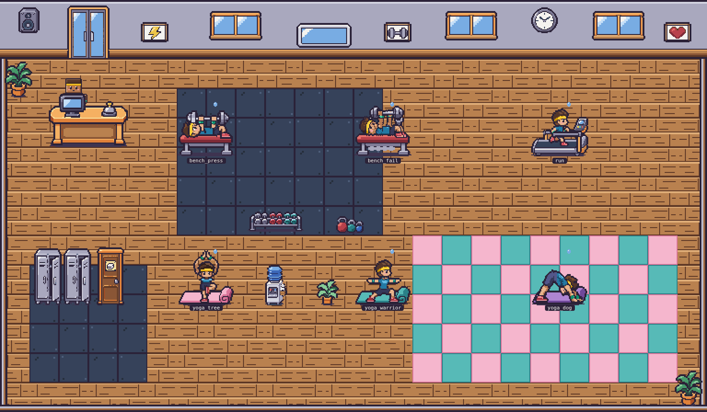

[Machine, frame and browser audit](checks.json)
