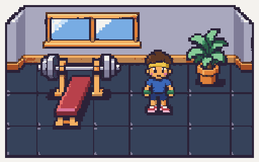
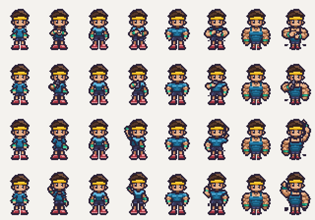
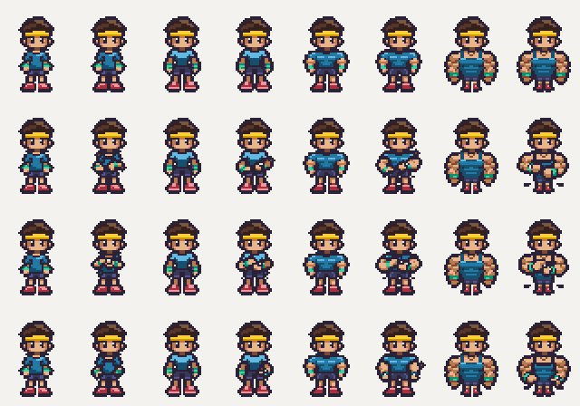
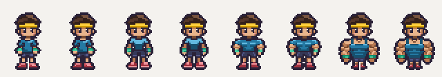
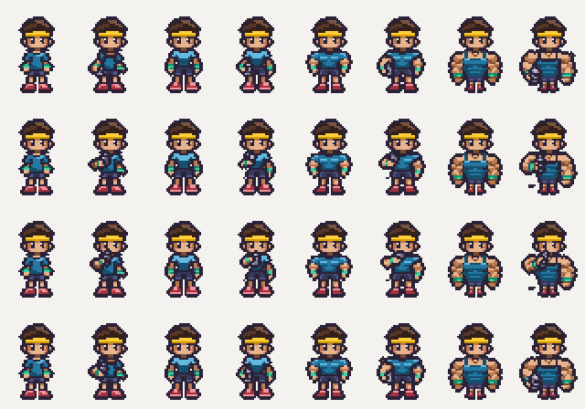
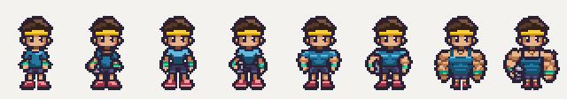
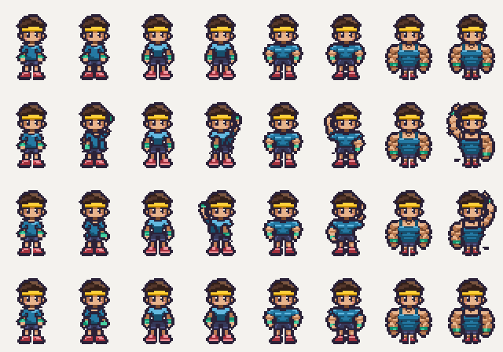
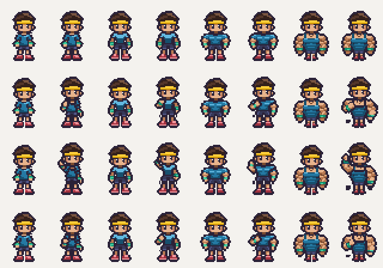

# Batch 7: waiting and celebrating, all four builds

Adds all **16 batch 7 strips**: wait_watch, wait_sip, wait_stretch and celebrate for Noodle (0), Toned (1), Buff (2) and Maxxed (3). Based on main at 0d4d36d, including the completed machine poses, hosting changes and batch 9 art. Every generation attached the approved style tile, the build's character reference and its idle_down strip, plus an integer 8× idle view for precision.

Every new strip starts from that build's idle_down body. Head and torso are retained at their approved sizes; the pose layers move the arms and accessories. Watch/stretch/celebrate frame 1 is the idle pose with only ink-outline repairs. Sip starts with the same body holding a grey metal bottle at the hip. The source idle strips and character references remain unchanged.

## How to read the 2× comparisons

**Pairs from left to right: Noodle (0) · Toned (1) · Buff (2) · Maxxed (3). Within every pair: idle_down on the LEFT, new action on the RIGHT.** PNGs use idle frame 1 as the static size reference. GIFs animate idle independently at 6 fps beside each action at its actual speed.

| Approved style tile at 2× | Four builds, each beside its idle_down at 2× |
| --- | --- |
|  |  |

[Open the looping overview](all-actions-vs-idle@2x.gif). [Approved idle bodies at 2×](idle-down-bodies@2x.png). Open any image to inspect the exact 2× source pixels.

## wait_watch — 4 frames at 6 fps

PNG rows show frames 1→4. Each row has all four builds, each next to idle_down.

## wait_sip — 4 frames at 6 fps

PNG rows show frames 1→4. Each row has all four builds, each next to idle_down.

## wait_stretch — 4 frames at 4 fps

PNG rows show frames 1→4. Each row has all four builds, each next to idle_down.

## celebrate — 4 frames at 10 fps

PNG rows show frames 1→4. Each row has all four builds, each next to idle_down.

## Body, palette and outline checks

All frames are 32×48 with anchor (16,46), soles on row 46 and row 47 empty. Waiting poses keep the original head position; celebrate translates the original head/torso by 0,-1,-2,0 pixels for a small bounce, retaining the requested foot line. Lower-body dimensions are retained; the bounce connects the raised hips to the planted feet. No rescaled heads or torsos.

The bottle uses only metal-1..4 plus ink, and is present in all 16 sip frames, with contact to the gripping hand. No other new action contains metal. The tiny watch dial uses nonswap cream/ink beside the green wristband. Skin, hair, shirt, bottoms, shoes, headband and wristbands retain their own swap ramps.

Every new frame passes the two-pixel silhouette audit, including internal negative spaces, hands, bottles and soles. A separate 64-frame check verifies the ink separation where raised arms meet the head. The approved head material pixels remain at their registered positions, except where the sipping bottle legitimately occludes the mouth.

## Cleanup and validation

Each strip ran through:

`pnpm pixelize strip ... --frames 4 --frame 32x48 --anchor 16,46 --scale 8 --palette character`

The broad Maxxed poses fill the 32-pixel cell, so the intermediate 8× cleanup images include magenta gutters between frames. Final assets remain 128×48 (4×32×48), with the original body scale. Pixelize's crop/centering is restored using integer translations; every registered byte matches the native grid after cleanup.

- 16 CLI cleanups and 16 `pnpm pixelize check ... --palette character --size 128x48` checks pass. No half alpha, off-palette colours, magenta or dimension changes.
- 16 strips/64 distinct phases pass body/head, outline, bottle and foot-baseline checks.
- `pnpm assets:status`: **103/127** v1 assets; exactly 16 new manifest presence flags.
- `pnpm test`: **99 passed**. `pnpm typecheck`: passed.
- Actual SpriteBank/viewer: 102 real runtime PNGs; all 16 watch, sip, stretch and celebration routes select the new real strips with exact frame counts, FPS and anchors.
- Browser-rendered 2× comparisons match the native composites pixel-for-pixel. Shirt recolouring changes only shirt pixels and leaves the metal bottles and other parts unchanged.
- References, palettes, prior character strips, props, tiles, application code, dependencies and asset definitions remain unchanged.

## Warnings

**No pixelize warnings** on the final 16 strips; all final checks pass. The browser's repeated pixel inspection emitted 16 Canvas2D readback performance advisories, with no runtime errors or failed requests. GIF timing is rounded to 10ms; the game retains the exact manifest speeds.

[Frame, head/body, outline, registration, palette, preview and browser audit](checks.json)
