# Batch 8: effects and UI

Adds all 24 `fx.*` and `ui.*` assets from the batch 8 inventory: five four-frame strips and 19 stills, 39 frames total. Sizes, frame counts, FPS, asset definitions and palettes are unchanged. `art/ASSETS.md` and `assets/manifest.json` are deliberately excluded.

Every source was generated separately with the built-in image tool, a solid #FF00FF background and the approved style tile attached. The headphone requests also attached the approved Toned character and the corresponding existing idle strip. [Exact prompts](prompts.json). Originals remain in ignored `art/raw/batch-8/<asset id>.png`.

## Every new asset next to the style tile at 2×

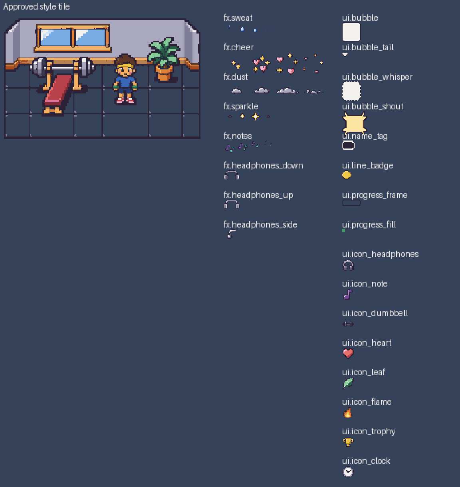

| Approved reference | Room context |
| --- | --- |
| 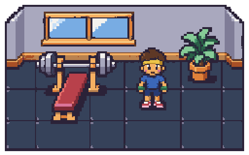 | 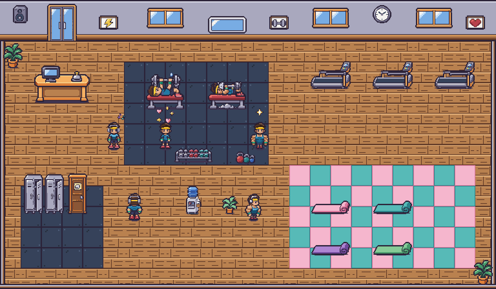 |

[Animated room at 2×](room.all-effects@2x.gif). Room composites use the existing floor, wall, props and characters with the same layout and sprite anchors as `GymRenderer`; these are art-review composites, not browser screenshots.

## Every effect in the gym at 2×

Each PNG presents all four phases in room context. GIFs loop at the asset's intended rate, rounded to GIF's 10ms timing increments. Actors are held still to isolate the effect.

| Effect | Four frames in room | Loop |
| --- | --- | --- |
| `fx.sweat` | 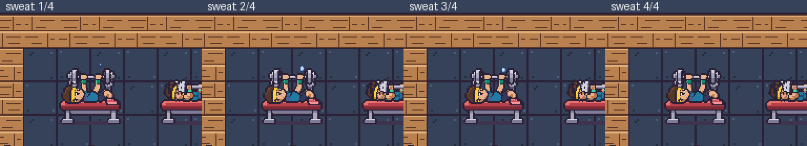 | 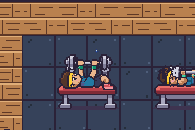 |
| `fx.cheer` | 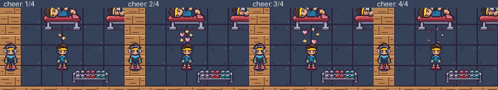 | 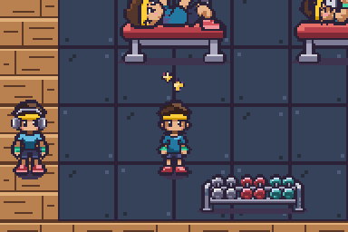 |
| `fx.dust` | 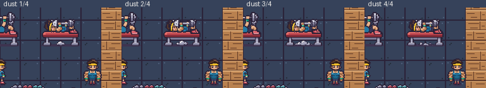 | 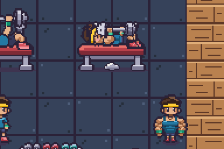 |
| `fx.sparkle` | 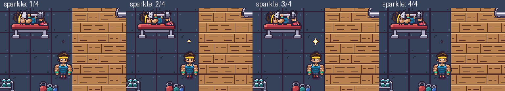 | 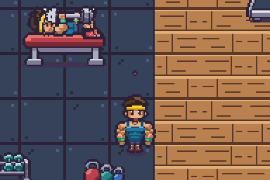 |
| `fx.notes` | 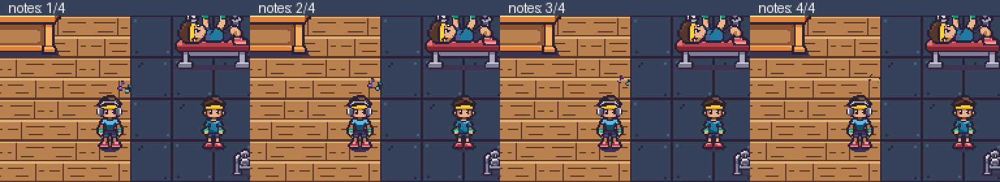 | 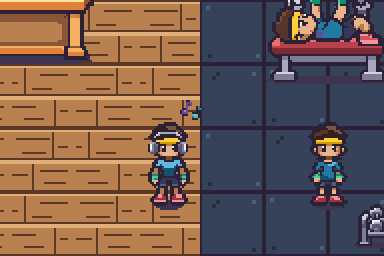 |

| Headphone view | In the gym at 2× |
| --- | --- |
| `fx.headphones_down` | 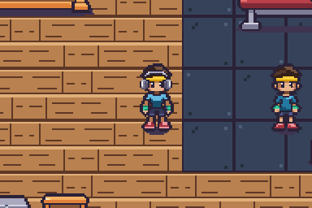 |
| `fx.headphones_up` | 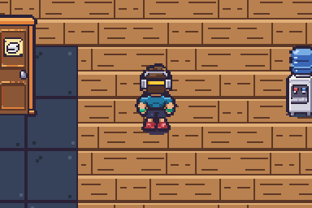 |
| `fx.headphones_side` | 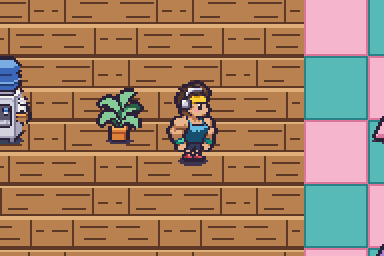 |

## Headphone registration

All three overlays are 20×12 and use only neutral ink/metal/cream entries from the character palette. No skin, hair, garment, headband or wristband swap colour occurs in them. They use the existing renderer placement: top-left **(6,9)** relative to a 32×48 idle frame, from the headphones' (10,11) anchor at character floor point minus 26 pixels. The side view is mirrored for left.

All four builds and all four idle frames are included below; the animation checks the accessory through the breathing cycle.


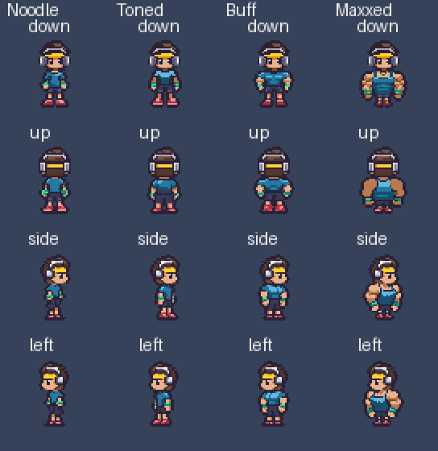

## UI at several sizes

All previews below are exported at 2×. The labels give the underlying art-pixel dimensions. The bubble, whisper, shout, name tag and progress frame use 9-slice scaling. Icons, tail and badge show integer nearest-neighbour size variants; the fill stretches in both directions.

| Asset | Fixed left/right caps | Fixed top/bottom caps | Plain centre |
| --- | --- | --- | --- |
| bubble | 8 | 8 | cream |
| bubble_whisper | 8 | 8 | cream |
| bubble_shout | 8 | 8 | yellow |
| name_tag | 4 | 4 | ink |
| progress_frame | 8 | 2 | transparent |

The small 16×12 name tag and 24×8 progress frame require smaller vertical caps to leave a stretchable centre. Every corner stays within the outer eight pixels. Whisper edge strips repeat their dotted pattern while the centre stretches. All four corner regions are checked byte-for-byte at every preview size; each source centre is one flat colour or fully transparent. The tail's open cream top joins the regular bubble without a dark seam.

| UI asset | Several sizes, displayed at 2× |
| --- | --- |
| `ui.bubble` | 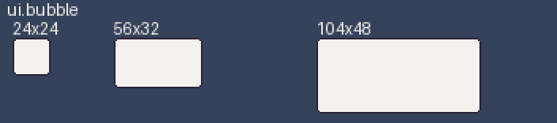 |
| `ui.bubble_tail` | 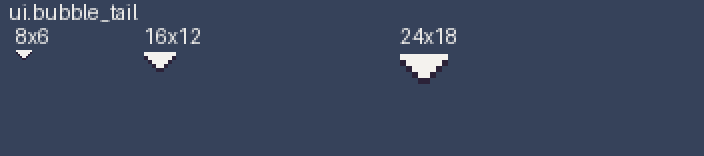 |
| `ui.bubble_whisper` | 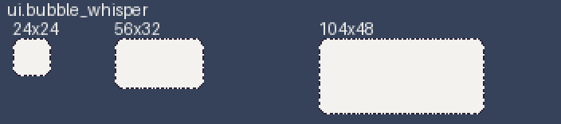 |
| `ui.bubble_shout` | 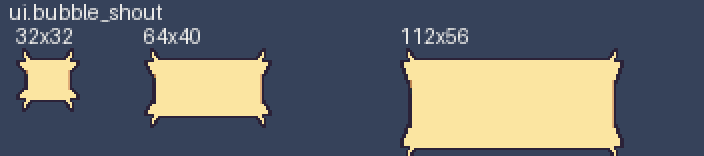 |
| `ui.name_tag` | 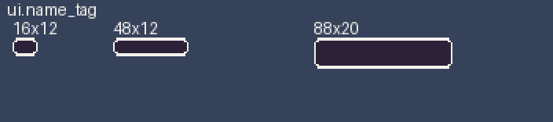 |
| `ui.line_badge` |  |
| `ui.progress_frame` | 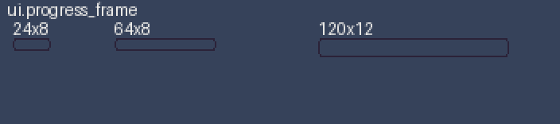 |
| `ui.progress_fill` | 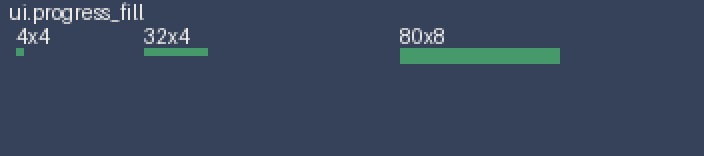 |
| `ui.icon_headphones` | 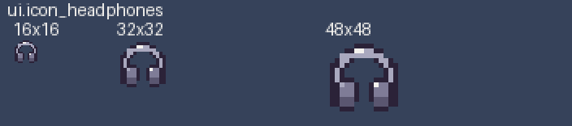 |
| `ui.icon_note` |  |
| `ui.icon_dumbbell` | 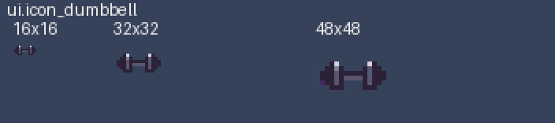 |
| `ui.icon_heart` | 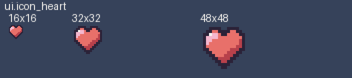 |
| `ui.icon_leaf` |  |
| `ui.icon_flame` | 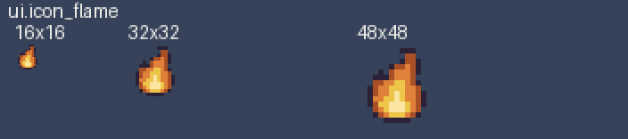 |
| `ui.icon_trophy` |  |
| `ui.icon_clock` | 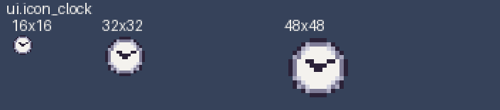 |

[All UI size comparisons on one sheet](ui.all-stretches@2x.png). [9-slice checks](ui-checks.json).

## Cleanup and warnings

The model returned enlarged rasters rather than literal 8-pixel blocks. Cleanup samples the intended art grid, expands it to an exact 8× grid, and runs the required `pnpm pixelize strip` or `sprite` command with `--scale 8`. Neutral source snapping prevents headphone raster drift from entering a character swap ramp. Integer translations restore the intended effect motion after pixelize's bottom-centre alignment; sweat and notes move two pixels per step, and dust contacts the floor. A pixel comparison verifies that all 20 effect frames survive strip placement without any lost, changed or clipped pixels.

The initial automatic-scale pass produced oversize/cropping warnings for the 19 stills and for sweat, dust and notes. Those outputs were discarded and replaced by the explicit-grid cleanup. The final run has **no oversize or clipping warnings** and only these expected effect-size warnings:

- `fx.sweat`: `Frame heights vary a lot (4, 7, 6, 2). The head may change size between frames.`
- `fx.cheer`: `Frame heights vary a lot (12, 22, 28, 25). The head may change size between frames.`
- `fx.sparkle`: `Frame heights vary a lot (4, 7, 12, 4). The head may change size between frames.`

These effects intentionally grow, disperse or shrink; they contain no character heads. Dust, notes and all 19 stills emit no final warnings. [Final cleanup commands and warnings](cleanup.json).

## Validation and reproduction

- All 24 `pnpm pixelize check` calls pass with the exact strip or still size and correct palette. Every frame is nonempty; each animation has at least three distinct phases. [Image audit](checks.json).
- Binary transparency throughout; no magenta or off-palette pixels.
- Headphones use only neutral character colours and have been reviewed on every idle frame of every build, in down/up/right/left views.
- `pnpm assets:status` ran successfully; both generated inventory files were restored byte-for-byte immediately afterwards.
- `pnpm test`: **99 passed** on current main. `pnpm typecheck`: passed. The first sandboxed test run could not bind the end-to-end server's loopback port; rerunning with local socket access passed the full suite.
- No gameplay or viewer behaviour changed.

From the repository root:

```sh
# Requires the ignored raw generations to be present.
pnpm --filter @benchmaxxers/pixelize exec tsx ../../art/previews/batch-8/clean.ts
# Runs the 24 checks and inventory check, restoring both generated files.
pnpm --filter @benchmaxxers/pixelize exec tsx ../../art/previews/batch-8/verify.ts
# Composites only; reads final assets. Requires Pillow.
python3 art/previews/batch-8/preview.py
```
