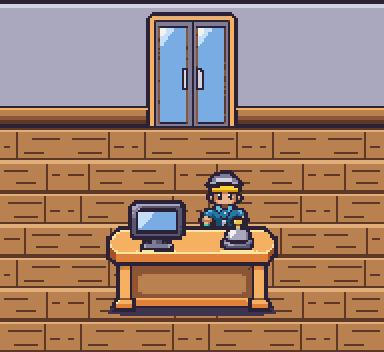
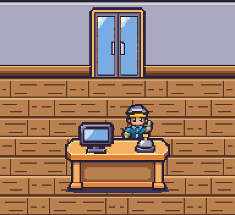
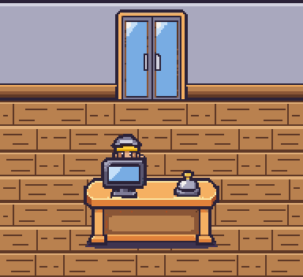
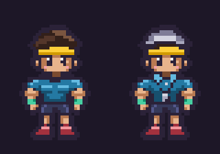
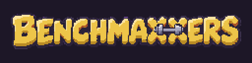
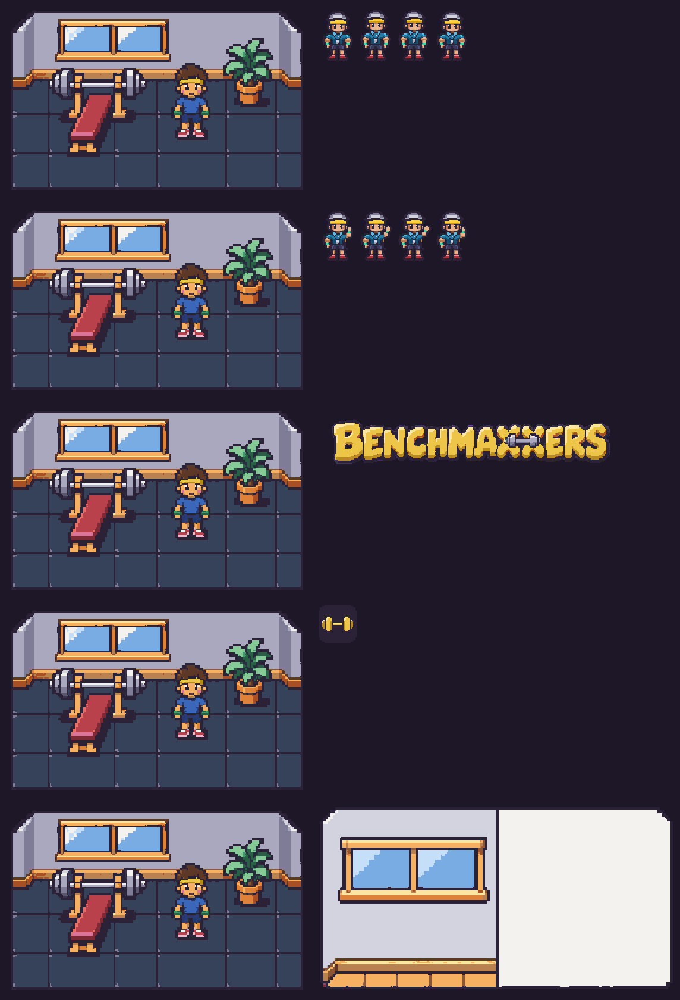

# Batch 9: Mark and the brand

Adds only `npc.mark.idle`, `npc.mark.wave`, `brand.logo`, `brand.mark` and `brand.recap_bg`. All five use their existing asset definitions, dimensions and palettes. Generated with built-in imagegen, one asset per image, with `art/reference/style-tile.png` attached to every request. Exact prompts and raw outputs remain local and ignored in `art/raw/batch-9/`.

| Asset | Finished PNG | Dimensions | Animation |
| --- | --- | --- | --- |
| Mark idle | [idle_down.png](../../../assets/characters/npc-mark/idle_down.png) | 128×48; four 32×48 cells | 6 fps; rest, inhale, inhale, rest |
| Mark wave | [wave_down.png](../../../assets/characters/npc-mark/wave_down.png) | 128×48; four 32×48 cells | 8 fps; four distinct hand poses |
| Wordmark | [logo.png](../../../assets/brand/logo.png) | 256×64 | Still |
| App icon | [mark.png](../../../assets/brand/mark.png) | 32×32 | Still |
| Recap background | [recap_bg.png](../../../assets/brand/recap_bg.png) | 300×157 | Still |

## Mark behind the front desk at 2×

These review plates use the approved desk, tiles, game Y anchors and draw order. Mark is placed **32 art pixels to the right of his current game position** so the existing monitor does not cover his face and uniform. This is a preview arrangement; the game layout is unchanged. Current-position previews are included below.

| Idle, 6 fps | Wave, 8 fps |
| --- | --- |
|  |  |

[All idle frames at 2×](npc.mark.idle.behind-desk@2x.png) · [All wave frames at 2×](npc.mark.wave.behind-desk@2x.png)

| Current game position: idle | Current game position: wave |
| --- | --- |
|  |  |

Mark starts from `art/reference/character-build-2.png` and `assets/characters/build-2/idle_down.png`. Cleanup preserves the approved Buff silhouette, face, skin, bands, shorts and shoes. The generated cap replaces the hair crown within its original silhouette; the polo collar, placket and whistle are registered onto the existing shirt. Every idle frame has the exact Buff alpha mask. The wave keeps the same head, torso, resting arm and legs; only the waving arm changes. No character shadow is baked in.

Approved Buff (left) and Mark (right), at 4× with identical feet lines:

## Logo on the page background

The illustrated letters spell **BENCHMAXXERS**, with yellow bevels, an ink outline and a small dumbbell across the Xs. No font or extra text. Preview uses the page's actual `#1d1727` background.

## Icon at 1× and 4×

| Native 1× | Nearest-neighbour 4× |
| --- | --- |
|  |  |

## Every new image beside the style tile at 2×

Top to bottom: Mark idle, Mark wave, logo, icon, recap background. All artwork is shown at exact 2×. The cream panel in the recap remains empty; `(154,10)` through `(287,146)` is verified flat `#F4F2EE` for game-added text.

## Cleanup and validation

- Cleaned every asset with `pnpm pixelize`. Mark's generated outfit and arm were registered to the approved native grid before a final `strip --scale 8 --frames 4 --frame 32x48 --anchor 16,46` pass. A one-pixel translation reverses pixelize's automatic horizontal centring on wave frame 3; the final pixels exactly match the registered grid. The logo is vertically centred with an integer translation after its sprite cleanup. The full-canvas recap uses `tile --key --size 300x157` to retain its card aspect and margins.
- All five final `pnpm pixelize check` calls pass with explicit expected sizes and the prescribed palettes: binary alpha, no magenta, no off-palette colors. **Pixelize cleanup warnings: none. Pixelize check warnings: none.**
- All eight character frames keep their lowest visible pixel on zero-based row 46; row 47 stays clear. Idle head offsets are `[0,-1,-1,0]`. Wave face and head pixels are fixed. All swap ramps remain on their own body parts; the cap and whistle use neutral metal colors.
- `pnpm test`: **82 passed**. `pnpm typecheck`: **passed**. GIF exports use exact shared color tables without dithering; playback totals are 670 ms for idle and 500 ms for wave.
- `pnpm assets:status` was run for validation. Its outputs were restored byte for byte: **neither `art/ASSETS.md` nor `assets/manifest.json` is included in this change**, as requested. Run it locally to enable the new art in the viewer.
- Approved references, other batches, palettes, asset definitions and application code are unchanged by this batch. The current renderer selects Mark's idle strip; the wave is supplied as the requested asset.

[Native-pixel and palette audit](checks.json)
