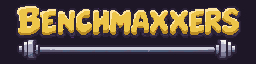
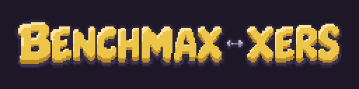
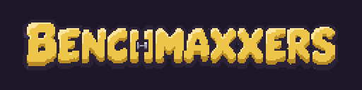
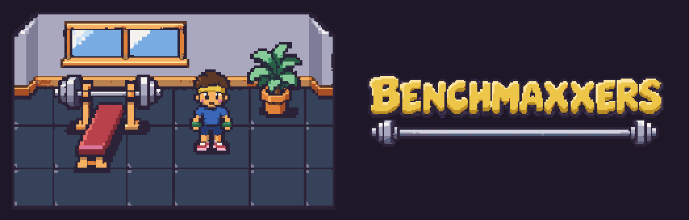
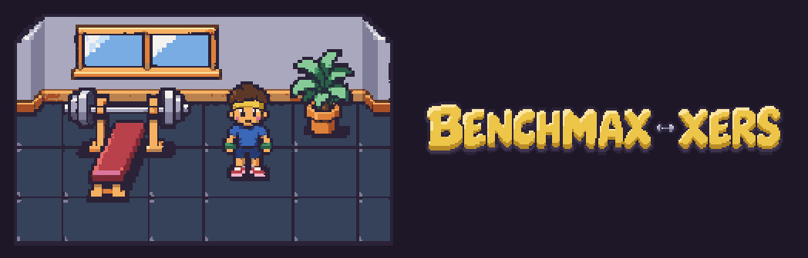
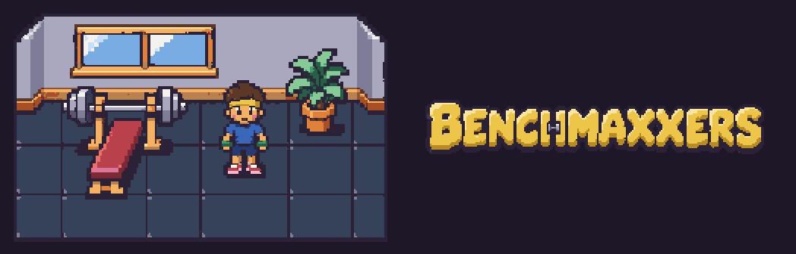

# Logo redo: three options awaiting selection

The current logo's dumbbell covers both Xs. These three 256×64 candidates keep the drawn, chunky bevelled yellow letters and ink outline, with every letter of **BENCHMAXXERS** visible at native size.

Based on latest `main` at `0d4d36d`. **No option is installed:** `assets/brand/logo.png`, `art/ASSETS.md` and `assets/manifest.json` are byte-for-byte unchanged. Selection is pending.

## Options at 1× and 2×

The following previews have a flat `#1d1727` background, matching the page. Native previews are exactly 256×64; 2× previews are exactly 512×128 with nearest-neighbour scaling. The linked source PNGs have transparent backgrounds.

| Option and transparent source | Native 1× | 2× |
| --- | --- | --- |
| **1. Under the word** — [option-1.png](option-1.png). A long barbell supports the complete word from below. |  |  |
| **2. Between the Xs** — [option-2.png](option-2.png). A small dumbbell sits in the gap between two complete X glyphs. |  |  |
| **3. H crossbar** — [option-3.png](option-3.png). A miniature dumbbell forms the crossbar between two continuous yellow H stems. |  |  |

## Style comparison at 2×

The approved tile and each candidate are shown at exact 2×.







## Generation and cleanup

Generated with built-in imagegen, one option per image. Every request attached both `art/reference/style-tile.png` and the unchanged current `assets/brand/logo.png`. Each image was generated on flat magenta, with the complete environment palette in its prompt. Raw images, exact prompts and local review helpers remain ignored under `art/raw/batch-9/logo-redo/`.

All three use the required sprite cleanup:

```bash
pnpm pixelize sprite art/raw/batch-9/logo-redo/brand.logo.option-1.png --size 256x64 --scale 9 --palette environment --out art/previews/logo-redo/option-1.png
pnpm pixelize sprite art/raw/batch-9/logo-redo/brand.logo.option-2.png --size 256x64 --scale 9 --palette environment --out art/previews/logo-redo/option-2.png
pnpm pixelize sprite art/raw/batch-9/logo-redo/brand.logo.option-3.png --size 256x64 --scale 9 --palette environment --out art/previews/logo-redo/option-3.png
```

After cleanup, each silhouette is centred vertically with an integer translation; no cleaned pixels are rescaled or clipped.

## Validation

- **All three `pnpm pixelize check … --palette environment --size 256x64` calls pass. Pixelize cleanup warnings: none. Pixelize check warnings: none.**
- Every candidate is 256×64, uses only the unchanged environment palette, has binary alpha and no remaining magenta.
- Visual review at 1×: all 12 letters read BENCHMAXXERS, with both X shapes complete and unobscured.
- Native-pixel review: the barbell in option 1 and the gap dumbbell in option 2 are separate connected components from all gold lettering. Option 3 has continuous gold paths down both H stems, on either side of its small metal crossbar.
- All candidates have clear margins. All dark-background 2× previews use nearest-neighbour scaling.
- `pnpm test`: **99 passed**. `pnpm typecheck`: **passed**.
- `pnpm assets:status` was run for validation, then its two generated outputs were restored byte for byte. The production logo remains unchanged.

[Dimensions, palette audit and protected-file checksums](checks.json)
