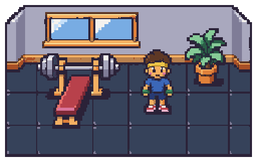
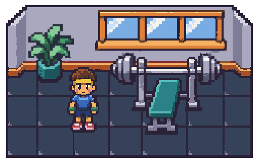
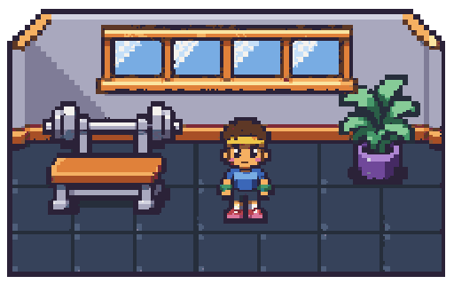

# Batch 1: style-tile candidates

Three alternatives for `ref.style_tile`, awaiting the maintainer's choice. Each is
256×160 art pixels and includes the rubber floor, windowed wall, bench with a
barbell, plant and front-facing Toned agent. No candidate has been promoted to
`art/reference/style-tile.png`; the approved asset remains pending.

The previews below are exact nearest-neighbor 2× enlargements (512×320 PNGs).
There is no approved style tile to compare against yet.

Revised toward a 16-bit console RPG look: chunkier pixel clusters, squarer
silhouettes, simpler shade ramps, compact sprites and more open tiled floor.
The three layout and accent-color alternatives are preserved.

## 1 — Red bench / terracotta pot

Double-pane window, warm wooden bench frame, agent on the right.



[256×160 candidate](style-tile-1.png)

## 2 — Teal bench / teal pot

Triple-pane window, steel bench frame, agent on the left.



[256×160 candidate](style-tile-2.png)

## 3 — Amber bench / purple pot

Four-pane window, lower side-on bench, smaller centered agent.



[256×160 candidate](style-tile-3.png)

## Cleanup and warnings

Redrawn in the 16-bit direction on magenta. Raw sources are
kept locally in ignored `art/raw/batch-1/ref.style_tile-{1,2,3}.png`.
Each final source is 1586×992; `pixelize tile` normalizes the full scene to the
required canvas, removes magenta with `--key` and snaps colors to the unchanged
environment palette specified for batch 1 in `ASSETS.md`.

| Candidate | Cleanup warnings | `pixelize check --palette environment --size 256x160` |
| --- | --- | --- |
| 1 | None | Passed |
| 2 | None | Passed |
| 3 | None | Passed |

The reported scale, `6.1953125`, is informational, not a warning. These are scene
references checked against the environment palette; the agent's colors are
remapped to that palette and are not a recolorable batch-2 character sprite.
Palette checks do not validate character proportions or per-body-part color
placement; those still require visual approval before later character batches.

Reproduce from the repository root with Node 24 and pnpm 10.32.1:

```bash
for i in 1 2 3; do
  pnpm pixelize tile "art/raw/batch-1/ref.style_tile-$i.png" \
    --size 256x160 --palette environment --key \
    --out "art/reference/candidates/style-tile-$i.png" || exit
  pnpm pixelize check "art/reference/candidates/style-tile-$i.png" \
    --palette environment --size 256x160 || exit
done
```

`pnpm assets:status` leaves the approved style tile incomplete until a candidate
is selected. No palettes, asset definitions, application code or tests were
changed for these candidates.
