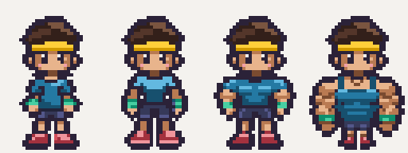
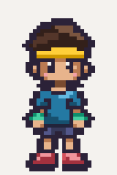
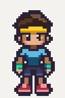
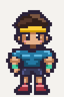
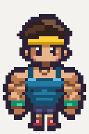

# Batch 3: standing body candidates

Body approval only. Each candidate is a single 32×48 down-facing frame; the last occupied row is 46 (zero-based), matching the approved Toned reference and pixelize's `16,46` anchor. No animations have been made for these builds.

## All four builds at 4×

Left to right: **Noodle (0), approved Toned (1), Buff (2), Maxxed (3)**. Nearest-neighbour scaling; cream is only the preview background. Native candidates have fully transparent backgrounds.



| Candidate | Body brief | Native file | 4× preview |
| --- | --- | --- | --- |
| Noodle / 0 | Narrow shoulders, thin arms, slightly dropped shoulders and a loose blue tee | [32×48 PNG](character-build-0.png) |  |
| Toned / 1 | Approved reference, shown for comparison | [Approved reference](../character-build-1.png) |  |
| Buff / 2 | Broad chest, bigger arms and a tight blue tee | [32×48 PNG](character-build-2.png) |  |
| Maxxed / 3 | Huge arms, very broad chest, blue tank and tiny legs | [32×48 PNG](character-build-3.png) |  |

## Style comparison at 2×

| Approved style tile | New standing candidates |
| --- | --- |
|  | Noodle:  Buff:  Maxxed:  |

All four at 2×:


## Generation and cleanup

- Started from `main` at `2973680`, which includes the approved batch 2 animations.
- Generated one image per body on magenta, attaching both `art/reference/style-tile.png` and `art/reference/character-build-1.png` to every request. Original outputs remain ignored under `art/raw/batch-3/`.
- Normalized the generated bodies to the native grid with pixelize, corrected palette collisions by body part, and strengthened exterior outlines. The approved head/neck area (rows 0–23) was copied unchanged into every candidate, preserving the exact face, hair, headband, colours and placement.
- Retained each swap ramp only on its own material: skin, blue top, navy shorts, red shoes and green wristbands. No metal colours or head-only colours appear in the new bodies.
- Exported exact 8× magenta staging images, then cleaned each with:

```sh
pnpm pixelize strip art/raw/batch-3/grid8-0.png --frames 1 --frame 32x48 --scale 8 --anchor 16,46 --palette character --out art/reference/candidates/character-build-0.png
pnpm pixelize strip art/raw/batch-3/grid8-2.png --frames 1 --frame 32x48 --scale 8 --anchor 16,46 --palette character --out art/reference/candidates/character-build-2.png
pnpm pixelize strip art/raw/batch-3/grid8-3.png --frames 1 --frame 32x48 --scale 8 --anchor 16,46 --palette character --out art/reference/candidates/character-build-3.png
```

## Validation and warnings

- `pnpm pixelize check <candidate> --palette character --size 32x48`: all three pass.
- Pixelize cleanup warnings: **none**. Pixelize check warnings: **none**.
- Additional pixel audit: exact dimensions, binary alpha, feet at row 46, clear canvas edges, identical approved head pixels, distinct bodies, and swap-colour regions checked.
- `pnpm assets:status`: **7/127**; the generated status files are unchanged because these are unapproved reference candidates.
- `pnpm test` and `pnpm typecheck`: pass.

The approved reference PNGs, palettes, production assets and asset definitions are unchanged. Body approval is required before promoting these candidates or making their animations.
