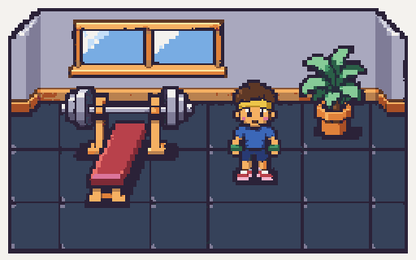
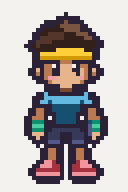
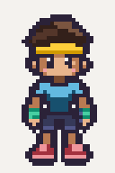
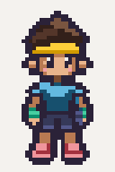

# Batch 2: Toned standing-frame candidates

Pulled `main` at `a01563e` before starting. Every generation attached the approved
`art/reference/style-tile.png`. These are three alternatives for **frame 1 only**
of `char.build-1.idle_down`, each 32×48, facing down, with the same Toned agent,
default outfit and chunky 16-bit drawing style. The differences are deliberately
small: 1 has a tiny smile, 2 a neutral mouth, 3 a slight shoe/stance variation.

The candidates are not approved references or complete idle animations. No file
has been written to `art/reference/character-build-1.png` or
`assets/characters/build-1/idle_down.png`. No additional frames or animations
were generated.

## Review

Candidate previews are exact nearest-neighbor **4×** enlargements (128×192) on
cream review backgrounds. The source PNGs have transparent backgrounds. The
approved style tile is shown at 2× for comparison.

| Approved style tile — 2× | Candidate 1 — 4× | Candidate 2 — 4× | Candidate 3 — 4× |
| --- | --- | --- | --- |
|  |  |  |  |

Originals: [1](character-build-1-1.png), [2](character-build-1-2.png),
[3](character-build-1-3.png).

## Cleanup, ownership and warnings

All final `pnpm pixelize check ... --palette character --size 32x48` commands
passed. **Pixelize warnings: none for all three.** Feet end at zero-based row 45,
leaving rows 46–47 empty, on the column-16 anchor. Alpha is binary; no magenta or
off-palette pixels remain.

The image generator exported 1024×1536 drafts. Initial fixed-scale-32 pixelize
passes produced the native grids. Additional pixel cleanup constrained ambiguous
hair/skin browns and cheek/shoe pinks to their actual body-part ramps, corrected
the second cheek on candidate 3, and strengthened thin exterior contours toward
the requested 2-pixel ink weight while retaining the small feet gap. Each result
was exported on an exact 8× magenta grid and passed through pixelize again at
`--scale 8`. Thin internal facial/hand/foot details remain single pixels where
needed. No palettes, asset definitions or game code were changed.

Native-pixel role masks were checked after the final pass: skin, hair, shirt,
shorts, shoes, headband and wristbands use only their own named ramps; cream is
confined to the two eye shines, blush to cheeks, and no metal colors are used.
This ownership audit is separate from the global palette check. Final images
and their 4× previews were visually compared with the approved tile.

Raw generations, 8× staging sources and cleanup masks stay local in ignored
`art/raw/batch-2/`. Final cleanup commands, from the repository root:

```bash
for i in 1 2 3; do
  pnpm pixelize strip "art/raw/batch-2/char.build-1.idle_down.candidate-$i.grid8.png" \
    --frames 1 --frame 32x48 --palette character --anchor 16,45 --scale 8 \
    --out "art/reference/candidates/character-build-1-$i.png" || exit
  pnpm pixelize check "art/reference/candidates/character-build-1-$i.png" \
    --palette character --size 32x48 || exit
done
```

`pnpm assets:status` still reports 1/127 approved assets, with the complete idle
strip pending. `pnpm test` passed all 82 tests; `pnpm typecheck` passed all four
packages. The approved style tile and generated asset-status files are unchanged.
