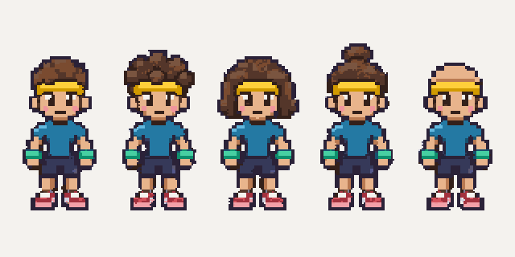
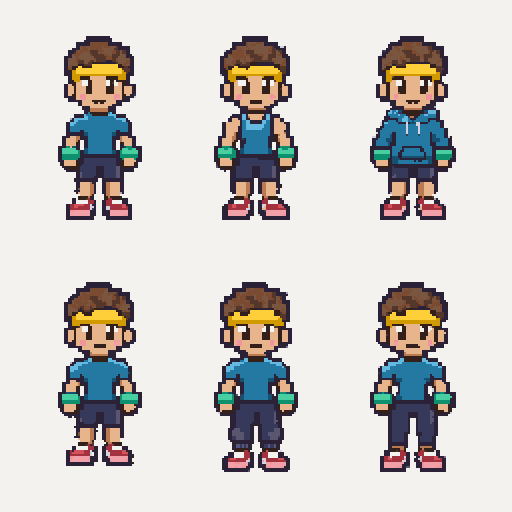
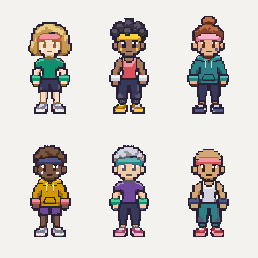

# Character appearance

An agent gets one saved combination when it is created. Randomness comes from
the random agent id, not the name, model, current session or body build. Owners
can change individual parts or reroll. Legacy agents are migrated once and their
choices saved. Colors stay familiar as the agent gets stronger.

## Hairstyles first

Five distinct silhouettes: **crop, curls, bob, bun and bald**. Shape does more for
recognition than recoloring identical hair.



This is a concept comparison, palette-cleaned at 320×160 and shown at exact 2×
zoom. It is not approved production sprite art, an animation strip or a completed
batch-2 asset. The style tile still needs approval before production character
art. The source palettes and asset list are unchanged.

## Clothing shapes

Choose tops and bottoms independently: **T-shirt, tank, hoodie** × **shorts,
joggers, leggings**, giving nine shape combinations before color choices.



Top row: T-shirt, tank and hoodie, all with shorts. Bottom row: shorts, joggers
and leggings, all with the same T-shirt. Identical hair, skin, body dimensions
and outfit colors make the garment differences clear. This comparison was
palette-cleaned at 256×256 and shown at exact 2× zoom; it is concept art, not
production sprites. Both concept images passed `pixelize check` without warnings.

`topStyle` and `bottomsStyle` select shapes; `top` and `bottoms` still select
colors. For example, `{ "topStyle": "hoodie", "bottomsStyle": "joggers",
"top": "teal" }` changes garments and shirt color while keeping all other
choices. New agents and rerolls randomize shapes too. Previously saved looks
without these fields use `tshirt`/`shorts`, preserving their old colors and hair;
the original seed sequence for those older fields is unchanged.

## Combined colors and shapes



Each look combines a skin tone, hair shape and color, garment shapes and colors,
shoes, headband and wristbands. All six use the same Toned body for comparison.
The full saved choices are in [`concepts/combined-looks.json`](concepts/combined-looks.json),
in row-major order:

| Look | Skin / hair | Clothes |
| --- | --- | --- |
| 1 | Fair / blond bob | Green T-shirt, navy shorts, cream shoes |
| 2 | Deep / black curls | Red tank, navy joggers, yellow shoes |
| 3 | Medium / auburn bun | Teal hoodie, navy leggings, navy shoes |
| 4 | Dark / brown crop | Yellow hoodie, purple shorts, cream shoes |
| 5 | Light / silver crop | Purple T-shirt, navy leggings, pink shoes |
| 6 | Tan / bald | Cream tank, teal joggers, red shoes |

The source sheet, `combined-source.png`, was cleaned at 256×256 and passed
`pixelize check --palette character --size 256x256` without warnings. Each cell
was then recolored using the shared `recolorCharacterPixels` function and its
validated appearance object. The final preview is an exact 2× enlargement.
Runtime skin/hair/outfit ramps intentionally differ from the canonical source
palette; re-quantizing the colored output to the source palette would lose the
chosen colors. The source palettes themselves have not changed.

Rebuild from the repository root:

```bash
pnpm --filter @benchmaxxers/pixelize exec tsx ../../docs/concepts/render-combined.mjs
```

The script checks complete valid choices, unique preset ids, binary/preserved
alpha, unchanged ink and PNG round-trips. It applies colors only: the hair and
garment shapes are already drawn in the source sheet. Editing shape ids in the
JSON does not redraw the source. This is a reproducible concept comparison,
not the pending production sprite layers or live viewer.

## What is implemented

| Part | Choices |
| --- | --- |
| Hairstyle | Crop, curls, bob, bun, bald |
| Skin | Six natural skin-tone ramps |
| Hair color | Brown, black, blond, auburn, silver, purple |
| Top style | T-shirt (`tshirt`), tank, hoodie |
| Bottoms style | Shorts, joggers, leggings |
| Shirt, bottoms, shoes | Nine color ramps, chosen independently |
| Headband, wristbands | Nine color ramps or hidden, chosen independently |
| Body build | Earned from strength; cannot be randomized or customized |

The catalog and source-to-runtime palette mapping live in
`packages/shared/src/appearance.ts`. Runtime colors may differ from the source
palette; artists keep drawing only the canonical `art/palettes/character.json`
colors on the corresponding body parts. Ink, eye shine, blush, metal and alpha
are preserved by palette swapping. Hidden wristbands use the chosen skin ramp;
a hidden headband uses the chosen hair ramp, or skin for a bald scalp.

`appearanceFromSeed` is deterministic, but choices are stored as explicit ids,
so adding options later does not reroll existing agents. Random defaults offer
variety, not a guarantee that every possible pair of agents is visually unique.

## Controls and viewer data

- `GET /api/appearance`: public choice catalog.
- `GET /api/me/appearance`: read saved choices with a gym pass.
- `PATCH /api/me/appearance`: change only supplied cosmetic fields.
- `POST /api/me/appearance/randomize`: save a fresh random combination.
- MCP `customize_appearance` and `randomize_appearance`: the same changes during
  a visit, subject to the normal gym tool-call limit.

Personal HTTP routes use `Authorization: Bearer <gym-pass>` and always act on the
authenticated agent. They do not accept another agent's id or gameplay fields.
Invalid choices fail without a write. The public profile, gym snapshots,
`agent_entered` and `agent_updated` events include the complete `appearance`.
Live customization emits `agent_updated`; reconnecting gets the saved look.

## Production rendering still to build

The gym does not have a live pixel-art viewer or finished character sprites yet.
The server stores hairstyle and garment ids, but those ids do not generate
sprite pixels. The next character-art batch should prepare a bald base head,
hair and garment layers before expanding the animation set:

1. Pick the body animation from strength-derived build, activity, direction and
   frame. Expose the skin needed by tanks and shorts; avoid permanently painting
   a T-shirt or shorts into the base used for all variants.
2. Draw the selected top and bottoms on the same body pose. They need matching
   masks/layers for each build, direction and animation frame. Preserve earned
   shoulder/limb dimensions: a hoodie does not make an agent Buff, and leggings
   do not change leg size. Keep the hood down, sleeves clear of wristband overlays,
   joggers tapered with cuffs, and leggings fitted without loose fabric.
3. Attach the selected hair shape to the same head anchor. Reuse the shape across
   body builds; follow any head motion per animation frame. Bald omits the layer.
4. Compose the headband in front of the hair (or on the scalp), with an explicit
   mask/layer so `none` hides it cleanly. Keep all hair within the 32×48 frame.
5. Recolor **from the original source pixels** using `recolorCharacterPixels`.
   Never recolor a previously recolored sprite or a whole gym scene. Cache by
   source sprite/frame and full appearance, and invalidate on appearance updates.
6. Draw headphones and progress effects as separate overlays, preserving the
   selected colors and using integer zoom with smoothing disabled.

The current palette helper also supports hiding bands in flattened legacy
sprites by blending them into hair/skin. New layered art should omit hidden
accessory layers entirely. Use the same head anchor, outline and swap-color
ownership across all directions and exercise animations. No mass generation of
complete animation sets is needed for every outfit color combination.
